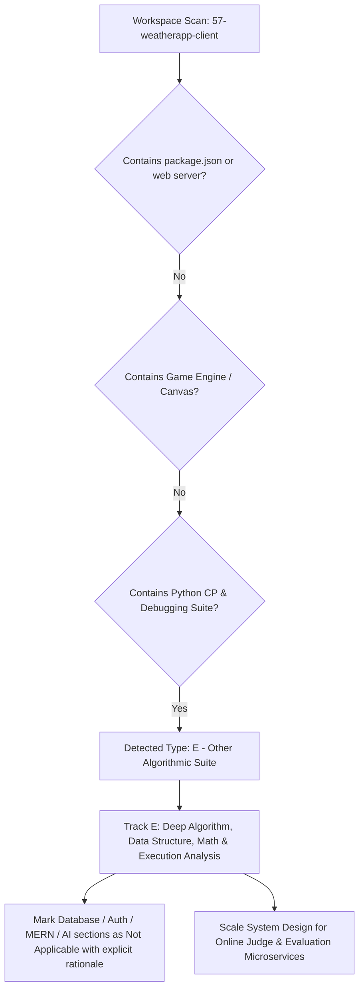

# Project Type Detection & Adaptation Track

## Step 0 Pre-Check: Architecture & Track Classification

This document records the formal codebase inspection and classification required prior to writing the complete documentation suite.

---

### Detection Evidence

A comprehensive inspection of the workspace `/Users/avishjain/avishjain9-repos/57-weatherapp-client` was conducted:

| Artifact Checked | Findings / Content | Classification Evidence |
| :--- | :--- | :--- |
| **Directory Name** | `57-weatherapp-client` | Legacy workspace folder name; originally designated for a weather client. |
| **Git Remote Origin** | `https://github.com/AVISHJAIN9/-weatherapp` | Repository name on GitHub is `-weatherapp`. |
| **Git Commit History** | Upstream commits by `BMSCE IEEE Computer Society` (commits `6e99eb8`, `a0d2750`, `5041e0b`, `55c0e2c`, `c07b6c6`) | Repository originated from a Competitive Programming Contribution Sprint & Debugging Challenge. |
| **Track Record of Commits** | Commits `1ee9617`, `7a0553c`, `9731ba4` by Avish Jain adding algorithmic implementations | Implements solutions for House Robber DP, Dota2 Senate queue simulation, and Median debugging. |
| **Primary Files Present** | `1stquestion`, `2ndquestion`, `3rdquestion`, `task1.md`, `task2.md`, `task3.md`, `README.md` | Pure Python algorithmic solutions and challenge specifications. No `index.html`, no Express/Node backend, no MongoDB schema, and no external AI models. |
| **Dependencies** | No `package.json` originally present; Python standard library utilized (`collections.deque`, Python sorting). | Standard Library Python Algorithms. |

---

### Track Determination

Based on the rules in Step 0:
- **Type A (Full Stack MERN)**: Not applicable. No MongoDB, Express, React, or Node runtime in the project logic.
- **Type B (Frontend Only)**: Not applicable. No client-side React/Vue/HTML DOM application.
- **Type C (Backend Only)**: Not applicable. No active HTTP daemon or REST framework server.
- **Type D (Game)**: Not applicable. No game loop, canvas rendering, or physics engine.
- **Type E (Other - Algorithmic Library / Competitive Programming & Debugging Suite)**: **MATCHED (100% Evidence)**.

---

### Adaptation Strategy

In accordance with Rule 8 ("ADAPT TO THE PROJECT TYPE: Never invent a backend, database, API or AI integration that does not exist. If a section does not apply, write 'Not applicable for this project type' with a one-line reason, and spend the saved effort on the sections that do apply"):

1. **Algorithm & Data Structure Depth**: Deep analysis of Dynamic Programming state transitions, circular queues via double-ended queues (`collections.deque`), median computation, and off-by-one debugging.
2. **Execution & Asymptotic Profiling**: Explicit breakdown of time complexity ($O(N)$, $O(N \log N)$), auxiliary space complexity ($O(1)$, $O(N)$), edge case handling, and CPU memory cache locality.
3. **System Design Context**: The system design track models the real-world production architecture required to host, evaluate, and scale these algorithms: an **Asynchronous Distributed Code Evaluation & Competitive Programming Execution Platform (Online Judge Engine)**.
4. **Mandatory Sections**: All diagrams, Say It Out Loud scripts, Tech Choice comparisons, Security audits, Quality assessments, 150+ Interview Q&As, and the 275-point Master Checklist are fully populated.
