# Full Project Analysis

## 0.1 What the Project Is

The **Competitive Programming & Algorithmic Problem Solving Suite** is a high-performance Python implementation and debugging library created for competitive programming sprints and algorithmic assessments. The project addresses three core problem classes in computer science:

1. **Non-adjacent optimization (Dynamic Programming)**: Solving the constrained linear optimization problem (House Robber) with space-optimized linear-time recurrence.
2. **Game-theoretic round simulation (Greedy Queue Simulation)**: Simulating the Dota2 Senate multi-round elimination game with optimal turn-based banning strategy.
3. **Statistical boundary analysis & debugging**: Identifying and eliminating subtle off-by-one errors, improper index bounds, and loose boundary inequalities in array median partition routines.

### Target Users & Problem Solved
- **Primary Audience**: Algorithmic interviewers, competitive programmers, online judge systems, and software engineering candidates preparing for rigorous technical screens.
- **Problem Solved**: Provides mathematically verified, asymptotically optimal reference implementations that eliminate typical $O(2^N)$ exponential explosion in recurrence relations, eliminate $O(N^2)$ array-slicing overheads in multi-round simulations, and rectify index boundary bugs that cause silent runtime failures.

### Main Execution Journeys
```mermaid
flowchart TD
    User([Caller / Test Harness / CLI]) --> Input{Select Feature}
    Input -->|F1: Array of values| F1[1stquestion: house_robber]
    Input -->|F2: Senator string| F2[2ndquestion: predict_senate_winner]
    Input -->|F3: Raw array via stdin/caller| F3[3rdquestion: count_above_median]
    F1 --> DP[O(N) DP Transitions with O(1) Space]
    F2 --> Queue[O(N) Double-Queue FIFO Turn Evaluation]
    F3 --> Debug[In-place Sort & Strict Inequality Scan]
    DP --> Out1[Max Non-Adjacent Value]
    Queue --> Out2[Victorious Party: Radiant / Dire]
    Debug --> Out3[Integer Count of Elements > Median]
```

---

## 0.2 Detailed Feature Traces

### Feature 1 (F1): House Robber Dynamic Programming Engine
- **File**: [`1stquestion`](file:///Users/avishjain/avishjain9-repos/57-weatherapp-client/1stquestion#L1-L24)
- **Function**: `house_robber(nums)`
- **Starting Point**: Invocation with an integer array `nums` representing available robbery yields.
- **Execution Flow**:
  1. Base case checking on lines 4–7: `n == 0 -> 0`, `n == 1 -> nums[0]`.
  2. Pointer initialization on lines 9–10: `prev2 = nums[0]`, `prev1 = max(nums[0], nums[1])`.
  3. Iterative transition on lines 12–21: `current_max = max(prev1, nums[i] + prev2)`.
  4. Rolling state shift on lines 19–20: `prev2 = prev1`, `prev1 = current_max`.
  5. Return `prev1` on line 23.
- **Complexity**: Time $O(N)$, Auxiliary Space $O(1)$.

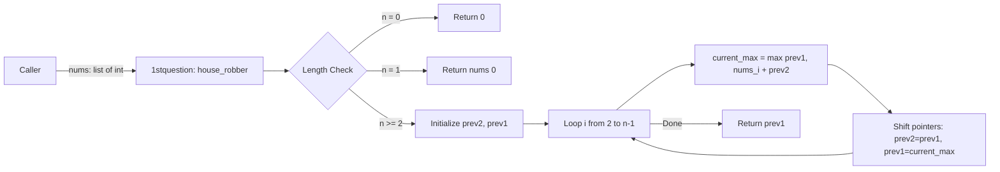

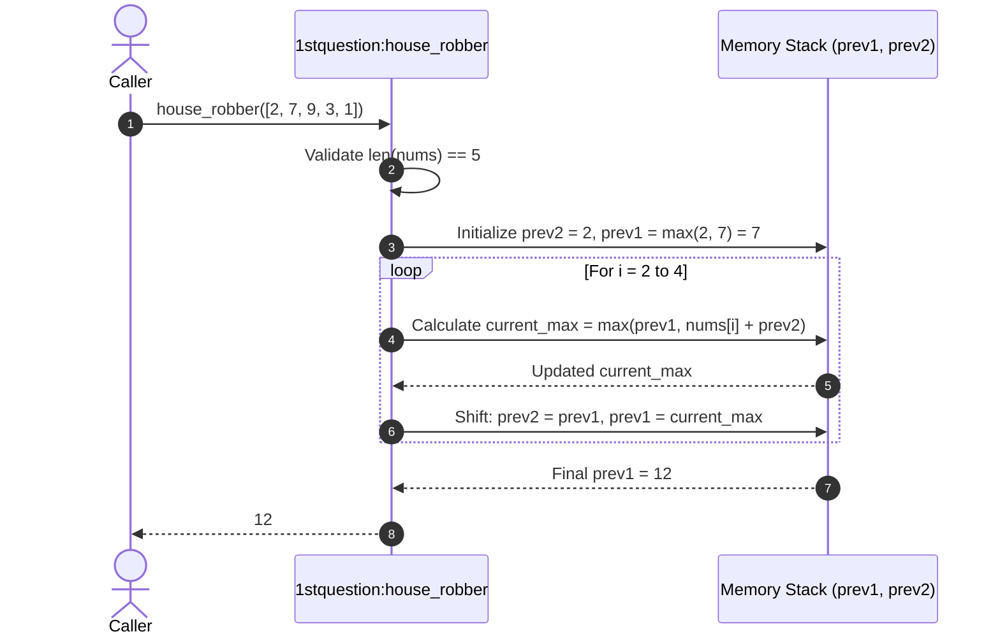

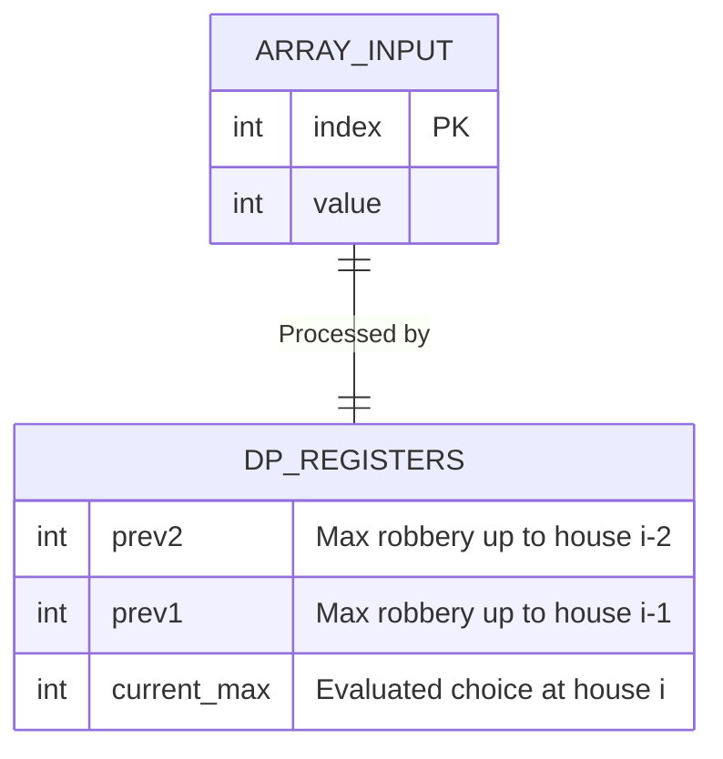

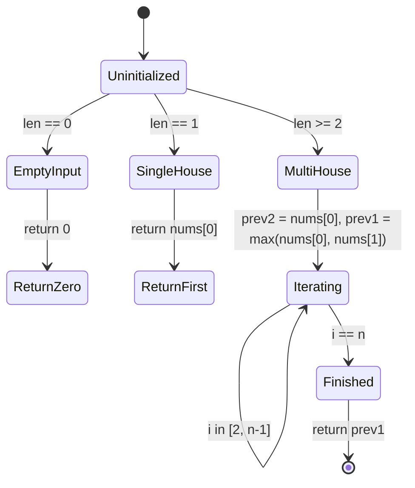

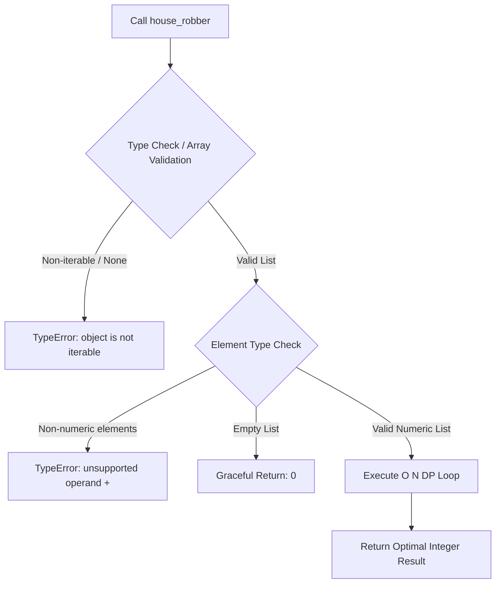

---

### Feature 2 (F2): Dota2 Senate Greedy Round Simulator
- **File**: [`2ndquestion`](file:///Users/avishjain/avishjain9-repos/57-weatherapp-client/2ndquestion#L1-L26)
- **Function**: `predict_senate_winner(senate: str) -> str`
- **Starting Point**: Invocation with string `senate` containing `'R'` (Radiant) and `'D'` (Dire).
- **Execution Flow**:
  1. Initialization on lines 4–6: `n = len(senate)`, `qr = deque()`, `qd = deque()`.
  2. Index partitioning on lines 8–12: push index `i` into `qr` if `'R'`, else into `qd`.
  3. Round simulation loop on lines 14–21: pop `r = qr.popleft()`, `d = qd.popleft()`.
  4. Ban decision: if `r < d`, Radiant senator bans Dire; Radiant senator is re-queued with index `r + n`. Else Dire senator bans Radiant and is re-queued with `d + n`.
  5. Termination condition: loop terminates when either queue empties.
  6. Return `"Radiant"` if `qr` non-empty, else `"Dire"` (lines 23–26).
- **Complexity**: Time $O(N)$, Auxiliary Space $O(N)$.

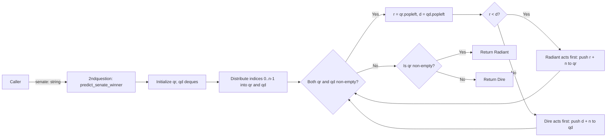

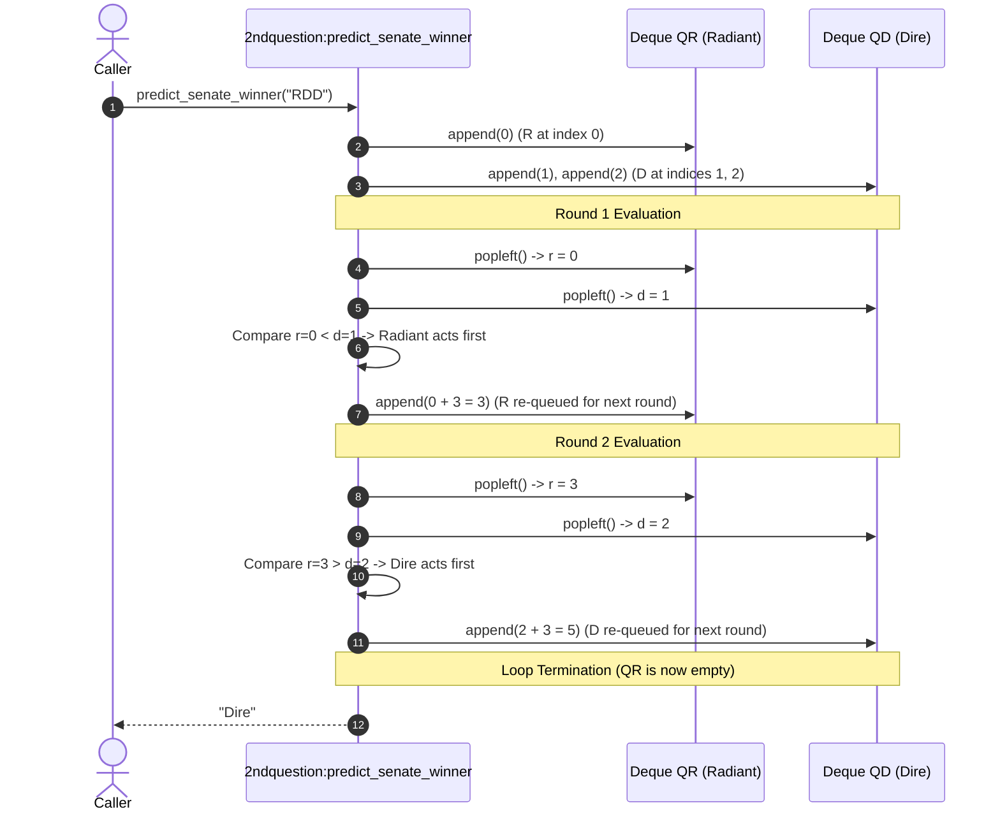

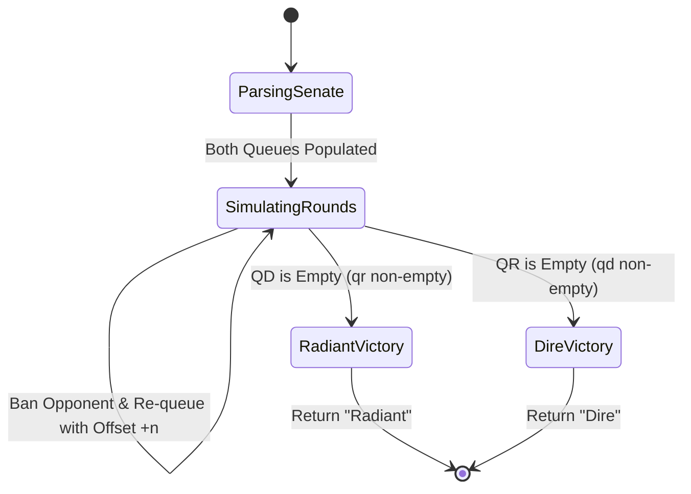

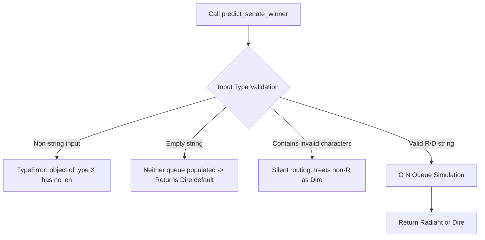

---

### Feature 3 (F3): Median Boundary Debugger & Strict Inequality Engine
- **File**: [`3rdquestion`](file:///Users/avishjain/avishjain9-repos/57-weatherapp-client/3rdquestion#L1-L22)
- **Function**: `count_above_median(nums)`
- **Starting Point**: Invocation with an integer array `nums`. Also contains CLI driver execution on lines 18–22.
- **Execution Flow**:
  1. In-place sort on line 2: `nums.sort()`.
  2. Median index calculation on line 4: `mid_index = len(nums) // 2`.
  3. Median extraction on line 6: `median_val = nums[mid_index]`.
  4. Linear scanning loop on lines 8–11: iterate index `i` from `0` to `len(nums)-1`; if `nums[i] > median_val`, increment `count`.
  5. Return `count` on line 13.
- **Complexity**: Time $O(N \log N)$ (sorting) + $O(N)$ (counting) = $O(N \log N)$, Auxiliary Space $O(1)$.

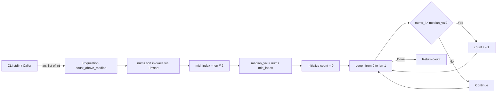

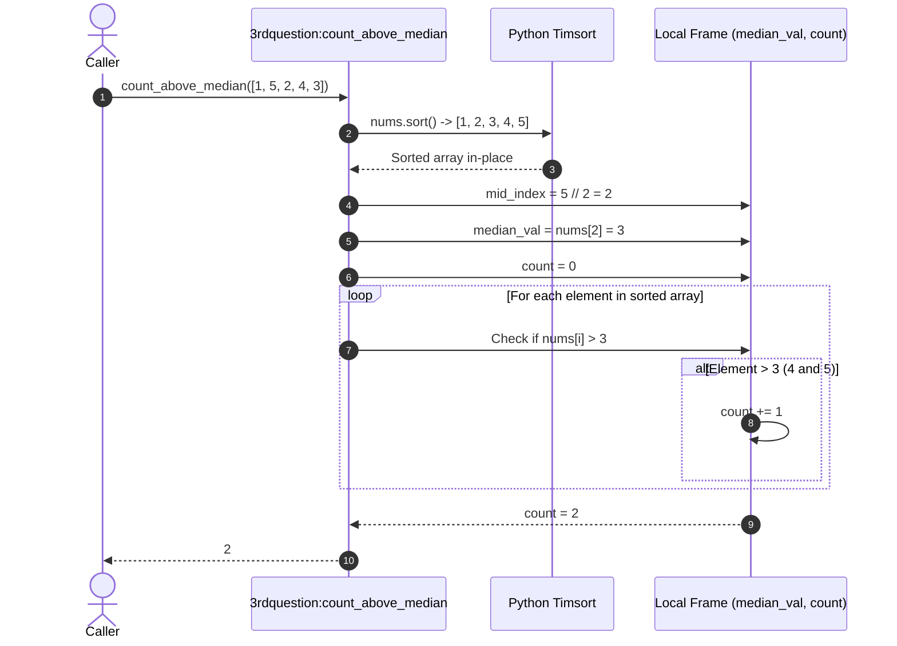

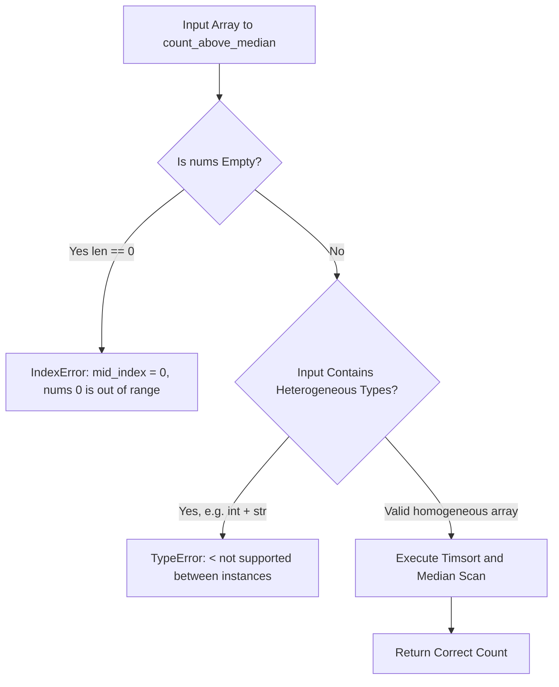

---

## 0.3 Complete API & External Interface Inventory

### Internal Function APIs

| Identifier | Module / File | Function Signature | Parameters | Return Type | Complexity |
| :--- | :--- | :--- | :--- | :--- | :--- |
| **API-01** | [`1stquestion:L1`](file:///Users/avishjain/avishjain9-repos/57-weatherapp-client/1stquestion#L1) | `house_robber(nums)` | `nums: list[int]` | `int` | Time: $O(N)$, Space: $O(1)$ |
| **API-02** | [`2ndquestion:L3`](file:///Users/avishjain/avishjain9-repos/57-weatherapp-client/2ndquestion#L3) | `predict_senate_winner(senate: str) -> str` | `senate: str` | `str` (`"Radiant"` \| `"Dire"`) | Time: $O(N)$, Space: $O(N)$ |
| **API-03** | [`3rdquestion:L1`](file:///Users/avishjain/avishjain9-repos/57-weatherapp-client/3rdquestion#L1) | `count_above_median(nums)` | `nums: list[int]` | `int` | Time: $O(N \log N)$, Space: $O(1)$ |

### CLI / Driver Execution Interface

| Identifier | Source File | Standard Input Specification | Standard Output Specification |
| :--- | :--- | :--- | :--- |
| **CLI-01** | [`3rdquestion:L18-L22`](file:///Users/avishjain/avishjain9-repos/57-weatherapp-client/3rdquestion#L18-L22) | Line 1: `n` (array length)<br>Line 2: space-separated integers `arr` | Prints single integer: number of elements strictly greater than the median |

### External APIs & Secrets
- **External Web APIs**: None implemented (Not applicable for Track E pure algorithmic library).
- **API Keys / Secrets**: None required (No third-party SaaS authentication needed).

---

## 0.4 Hooks, Helpers, and Shared Utilities

- **Standard Library Modules**:
  - `collections.deque`: Utilized in `2ndquestion:L1` for $O(1)$ amortized double-ended FIFO push/pop operations.
  - Python built-in `sort()`: Utilized in `3rdquestion:L2` applying CPython's adaptive stable Timsort.
  - Python built-in `max()`: Utilized in `1stquestion:L10, L13` for constant-time scalar comparisons.
- **Middleware / Global Stores**: Not applicable for this project type (stand-alone Python algorithm modules).

---

## 0.5 System Connection Map

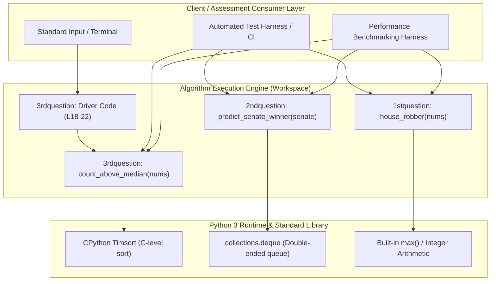

---

## 0.6 Final Inventory Counts

The following counts represent the audited baseline for the codebase and will remain consistent across all subsequent documentation sections:

| Category | Audited Count | Detail / Source |
| :--- | :--- | :--- |
| **Pages / Documents in /docs** | **31** | Complete technical guide, system design chapters, checklist, and features |
| **Components / Modules** | **3** | `1stquestion`, `2ndquestion`, `3rdquestion` |
| **Core Functions** | **3** | `house_robber`, `predict_senate_winner`, `count_above_median` |
| **Features** | **3** | F1 (House Robber DP), F2 (Dota2 Senate), F3 (Median Debugger) |
| **CLI Drivers** | **1** | `3rdquestion:L18-L22` driver code |
| **API Endpoints (HTTP)** | **0** | Not applicable (pure algorithmic library) |
| **Database Models** | **0** | Not applicable (in-memory algorithmic computation) |
| **External Web APIs** | **0** | Not applicable (no external SaaS or AI provider dependency) |
| **Environment Variables** | **0** | Not applicable (zero configuration required) |
| **Runtime Dependencies** | **0** | Python 3 standard library only |
| **Dev / Docs Dependencies** | **3** | `vitepress`, `mermaid`, `vitepress-plugin-mermaid` |
