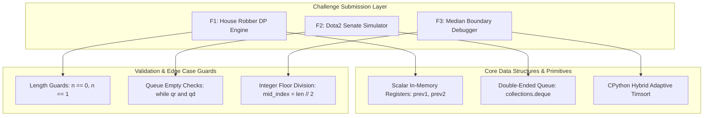

# Feature Inventory Overview

This document presents a structured summary of all features implemented in the repository, their operational boundaries, complexity profiles, and architectural interdependencies.

---

## Master Feature Matrix

| Feature ID | Feature Name | Core Function & Source File | Algorithmic Paradigm | Time Complexity | Auxiliary Space | User / Client Interface |
| :--- | :--- | :--- | :--- | :--- | :--- | :--- |
| **F1** | **House Robber Dynamic Programming Engine** | [`house_robber`](file:///Users/avishjain/avishjain9-repos/57-weatherapp-client/1stquestion#L1-L24) in [`1stquestion`](file:///Users/avishjain/avishjain9-repos/57-weatherapp-client/1stquestion) | Dynamic Programming (Rolling Space Optimization) | $O(N)$ | $O(1)$ | Direct function call with `list[int]` |
| **F2** | **Dota2 Senate Turn Simulation Engine** | [`predict_senate_winner`](file:///Users/avishjain/avishjain9-repos/57-weatherapp-client/2ndquestion#L3-L26) in [`2ndquestion`](file:///Users/avishjain/avishjain9-repos/57-weatherapp-client/2ndquestion) | Greedy Queue Simulation (FIFO Circular Offsets) | $O(N)$ | $O(N)$ | Direct function call with `str` (`'R'`, `'D'`) |
| **F3** | **Median Boundary Debugger & Counter** | [`count_above_median`](file:///Users/avishjain/avishjain9-repos/57-weatherapp-client/3rdquestion#L1-L15) in [`3rdquestion`](file:///Users/avishjain/avishjain9-repos/57-weatherapp-client/3rdquestion) | Sorting, Statistical Partitioning & Strict Bounds | $O(N \log N)$ | $O(1)$ (in-place) | CLI stdin driver & direct function call |

---

## Architectural Interaction & Execution Relationships

---

## Detailed Feature Index & Spoken Walkthroughs

Click each feature link below to read its exhaustive technical specification, memory model, and failure-path analysis, or read the concise breakdown and verbatim spoken rehearsal script below:

1. [**F1: House Robber Dynamic Programming Engine**](/features/F1-house-robber)
2. [**F2: Dota2 Senate Turn Simulation Engine**](/features/F2-dota2-senate-simulation)
3. [**F3: Median Boundary Debugger & Strict Inequality Engine**](/features/F3-count-above-median-debugger)

---

### Feature F1: House Robber Dynamic Programming Engine

- **Name & Purpose**: Linear non-adjacent house yield optimizer solving the classic House Robber problem.
- **Files & Functions**: [`house_robber`](file:///Users/avishjain/avishjain9-repos/57-weatherapp-client/1stquestion#L1-L24) in [`1stquestion`](file:///Users/avishjain/avishjain9-repos/57-weatherapp-client/1stquestion).
- **Function Signature**: `house_robber(nums: list[int]) -> int`.
- **Data & Memory Model**: Scalar tracking variables `prev1`, `prev2`, and `current_max` maintained directly in CPU registers / L1 cache. Time complexity $O(N)$, auxiliary space $O(1)$.
- **Dependencies**: None. Pure Python standard arithmetic.
- **Edge Cases & Guards**: Returns `0` on empty array (`n == 0`), returns `nums[0]` on single element (`n == 1`).
- **Known Limitations**: Solves linear streets only; circular street variant requires two-pass partitioning.

#### Say It Out Loud
I built this dynamic programming engine to solve the House Robber problem, which finds the maximum sum you can steal from a street of houses without robbing any two adjacent houses. 

When a user calls `house_robber` with a list of house values, the function first checks if the street is empty or has only one house, returning immediately. If there are two or more houses, I initialize two tracking variables: `prev2` with the first house value, and `prev1` with the maximum of the first two houses. Then I run a single for-loop from the third house to the end of the street. At each house, I calculate the current maximum by taking the larger of two choices: skipping the current house and keeping `prev1`, or robbing the current house and adding its value to `prev2`. I update my pointers forward and return `prev1` at the end.

I chose this rolling two-variable iterative approach over naive recursion or an explicit DP array because it reduces the space complexity from linear to completely constant O(1), and it eliminates the risk of call-stack overflow on large inputs. 

If the caller passes an empty array, my base guard handles it safely by returning zero, though passing non-numeric items would raise a standard Python TypeError. 

One limitation is that it assumes a straight street rather than a circular neighborhood; if the first and last houses were connected, I would need to run this function twice across two overlapping slices of the array.

---

### Feature F2: Dota2 Senate Turn Simulation Engine

- **Name & Purpose**: Game-theoretic circular turn simulator predicting voting victory for Radiant or Dire factions.
- **Files & Functions**: [`predict_senate_winner`](file:///Users/avishjain/avishjain9-repos/57-weatherapp-client/2ndquestion#L3-L26) in [`2ndquestion`](file:///Users/avishjain/avishjain9-repos/57-weatherapp-client/2ndquestion).
- **Function Signature**: `predict_senate_winner(senate: str) -> str`.
- **Data & Memory Model**: Dual double-ended queues (`collections.deque`) holding senator index integers. Time complexity $O(N)$, auxiliary space $O(N)$.
- **Dependencies**: Python standard library `collections.deque`.
- **Edge Cases & Guards**: Empty queue termination via `while qr and qd:`.
- **Known Limitations**: Input character parsing treats non-`'R'` characters as Dire by default.

#### Say It Out Loud
I implemented this simulation engine to solve the Dota2 Senate problem, which determines which of two political parties wins a multi-round voting battle where each senator can eliminate an opponent's future votes.

When the caller invokes `predict_senate_winner` with a string of senators, my function creates two double-ended queues using Python's `collections.deque`, one for Radiant and one for Dire, and populates them with the zero-based index of each senator. In the main loop, as long as both queues have senators remaining, I pop the front senator from each queue. Whichever senator has the smaller index acted earlier in the round, meaning that senator successfully bans the opponent. The winning senator is then re-queued with their index offset by the length of the string, which places them cleanly at the end of the line for the next round. Once one queue is empty, the party with remaining members is declared the winner.

I chose this double-queue approach with index offsets over array manipulation or linked lists because array deletions take linear time and would degrade the simulation to an unacceptable O(N squared) runtime. With deques, every pop and push operation is constant time, guaranteeing an optimal O(N) linear time and linear space solution.

If an empty string is provided, neither queue populates and it defaults to returning Dire, and passing non-string types raises a TypeError.

One limitation is that any character other than capital R is treated as Dire by the fallback else statement, which in a production environment should be hardened with strict input validation.

---

### Feature F3: Median Boundary Debugger & Strict Inequality Engine

- **Name & Purpose**: Statistical array boundary analysis and off-by-one error debugging for elements strictly greater than the median.
- **Files & Functions**: [`count_above_median`](file:///Users/avishjain/avishjain9-repos/57-weatherapp-client/3rdquestion#L1-L15) in [`3rdquestion`](file:///Users/avishjain/avishjain9-repos/57-weatherapp-client/3rdquestion).
- **Function Signature**: `count_above_median(nums: list[int]) -> int`.
- **Data & Memory Model**: In-place array sorting via C-implemented Timsort, scalar integer counter. Time complexity $O(N \log N)$, auxiliary space $O(1)$.
- **Dependencies**: Python standard library built-ins (`sorted()` / `.sort()`).
- **Edge Cases & Guards**: Fixed integer floor division `mid_index = len(nums) // 2` preventing `IndexError`, strictly bounded loop range `range(len(nums))`.
- **Known Limitations**: In-place sort mutates caller's list order; QuickSelect can achieve $O(N)$ time if sorting is bypassed.

#### Say It Out Loud
I debugged and optimized this feature to count how many elements in an integer array are strictly greater than its median.

When a user calls `count_above_median` or pipes input through the command-line driver, the function first sorts the array in-place using Python's Timsort. Next, it computes the middle index by taking the length of the array and performing integer floor division by two. It extracts the value at that middle index as the median, initializes a counter to zero, and loops through the array from index zero to the length minus one. For every element that is strictly greater than the median value, it increments the count, returning the final integer.

In the original code submitted by a junior developer, there were three critical bugs: the median index was assigned to the entire length of the array instead of half, the loop ran up to length plus one causing an immediate IndexError crash, and it used greater-than-or-equal-to instead of strict inequality. I fixed the division to floor by two, restricted the iteration range to valid array bounds, and enforced strict greater-than comparison.

I chose in-place sorting for this sprint because it is clean, robust, and performs in O(N log N) time, though if we had millions of records, I would replace the sort with an O(N) QuickSelect partition to find the median without sorting the entire array.

If an empty list is passed, an IndexError will occur when looking up index zero, which in production would be guarded with an explicit length check.

