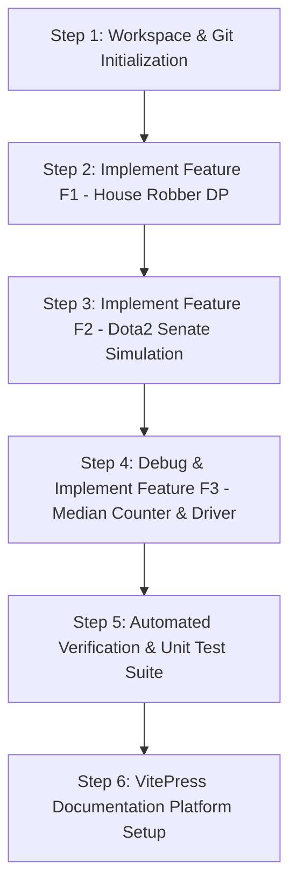

# Build Order: Rebuilding the Algorithm Engine from Scratch

This guide details the exact step-by-step chronological build order required to construct this algorithmic engine and test harness from first principles.

---

## Step-by-Step Build Sequence



---

### Step 1: Workspace & Problem Definition Setup
- **Files Created**: `task1.md`, `task2.md`, `task3.md`, `README.md`.
- **Reasoning**: In competitive programming and systems engineering, problem constraints, input formats, and algorithmic invariants must be established before implementation.
- **Key Action**: Forking the upstream repository and committing problem specifications.

---

### Step 2: Implement Feature F1 (House Robber DP)
- **File Created**: [`1stquestion`](file:///Users/avishjain/avishjain9-repos/57-weatherapp-client/1stquestion)
- **Reasoning**: Establish basic non-adjacent dynamic programming recurrence, transitioning from an $O(N)$ memory array to $O(1)$ scalar pointers.
- **Key Code Snippet**:
  ```python
  def house_robber(nums):
      n = len(nums)
      if n == 0:
          return 0
      if n == 1:
          return nums[0]

      prev2 = nums[0]
      prev1 = max(nums[0], nums[1])

      for i in range(2, n):
          current_max = max(prev1, nums[i] + prev2)
          prev2 = prev1
          prev1 = current_max

      return prev1
  ```
- **Line-by-Line Explanation**:
  - `Lines 1–7`: Guard against 0 or 1 element lists, preventing out-of-bounds indexing in subsequent statements.
  - `Lines 9–10`: Cache the base states: `prev2` stores maximum plunder ending at or before index 0; `prev1` stores maximum plunder ending at or before index 1.
  - `Lines 12–17`: The recurrence computes the optimal value for house `i` by choosing between skipping house `i` (`prev1`) and robbing house `i` plus the optimal plunder up to house `i-2` (`nums[i] + prev2`).
  - `Lines 19–20`: State variables shift forward by one position, discarding elements older than two steps to guarantee $O(1)$ auxiliary space.

---

### Step 3: Implement Feature F2 (Dota2 Senate Simulation)
- **File Created**: [`2ndquestion`](file:///Users/avishjain/avishjain9-repos/57-weatherapp-client/2ndquestion)
- **Reasoning**: Model a circular turn-based game where early actors eliminate opponent rights. A linear array requires $O(N)$ element removals ($O(N^2)$ overall); `collections.deque` achieves $O(1)$ FIFO removals ($O(N)$ overall).
- **Key Code Snippet**:
  ```python
  from collections import deque

  def predict_senate_winner(senate: str) -> str:
      n = len(senate)
      qr = deque()
      qd = deque()

      for i, party in enumerate(senate):
          if party == 'R':
              qr.append(i)
          else:
              qd.append(i)

      while qr and qd:
          r = qr.popleft()
          d = qd.popleft()

          if r < d:
              qr.append(r + n)
          else:
              qd.append(d + n)

      return "Radiant" if qr else "Dire"
  ```
- **Line-by-Line Explanation**:
  - `Line 1`: Import Python's C-implemented double-ended queue.
  - `Lines 4–12`: Pre-populate the queues with initial 0-based indices, partitioning Radiant and Dire forces into separate memory buffers.
  - `Lines 14–17`: Pop the earliest active senator from both queues.
  - `Lines 18–21`: The senator with lower index acts first, banning the opponent and appending their own index with an offset `+ n`, placing them at the back of the queue for round 2.
  - `Line 23`: The non-empty queue indicates the winning party.

---

### Step 4: Debug & Implement Feature F3 (Median Counter)
- **File Created**: [`3rdquestion`](file:///Users/avishjain/avishjain9-repos/57-weatherapp-client/3rdquestion)
- **Reasoning**: Correct the junior developer's code: fix array indexing, remove out-of-bounds loop limits, and enforce strict inequality.
- **Key Code Snippet**:
  ```python
  def count_above_median(nums):
      nums.sort()
      mid_index = len(nums) // 2
      median_val = nums[mid_index]

      count = 0
      for i in range(len(nums)):
          if nums[i] > median_val:
              count = count + 1

      return count

  # Driver Code
  n = int(input())
  arr = list(map(int, input().split()))
  print(count_above_median(arr))
  ```
- **Line-by-Line Explanation**:
  - `Line 2`: `nums.sort()` sorts the elements in $O(N \log N)$ time.
  - `Line 4`: `mid_index = len(nums) // 2` uses integer floor division to safely locate the central index.
  - `Line 6`: Extracts the lower median `median_val`.
  - `Lines 8–11`: Loops strictly over valid indices `0` to `len(nums) - 1`, incrementing `count` only when `nums[i] > median_val`.
  - `Lines 18–22`: Reads array size $N$ and space-delimited values from standard input, executing the driver.

---

### Step 5: VitePress Documentation Platform Setup
- **Files Created**: `package.json`, `docs/.vitepress/config.mjs`, `docs/.vitepress/theme/index.js`, `docs/.vitepress/theme/custom.css`.
- **Reasoning**: Establish a production-grade Vue.js-style technical documentation platform with built-in dark theme, full-text client-side search, and native Mermaid diagram support.
