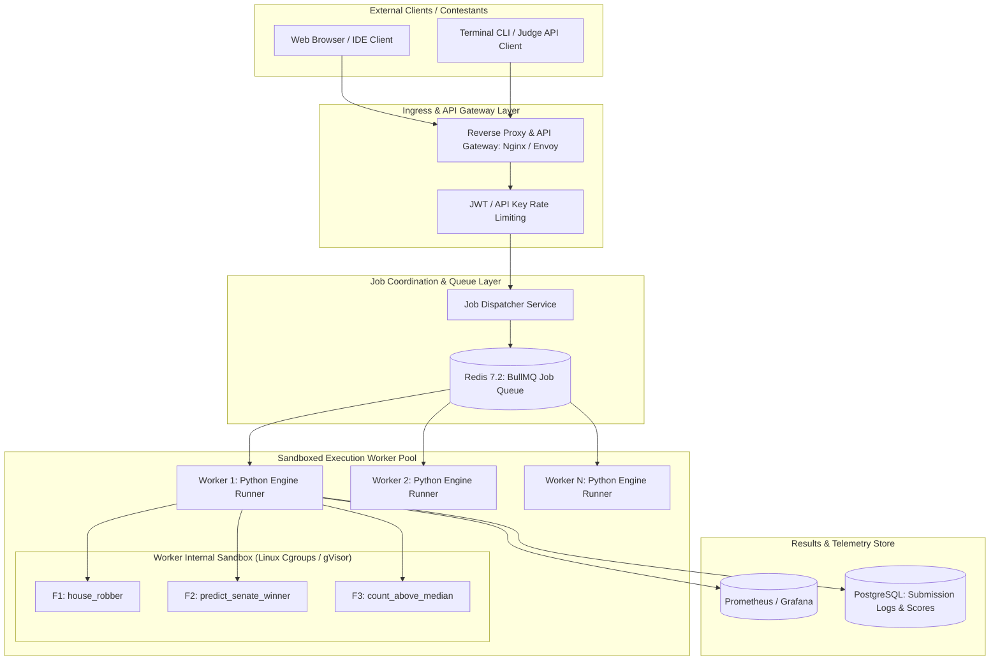
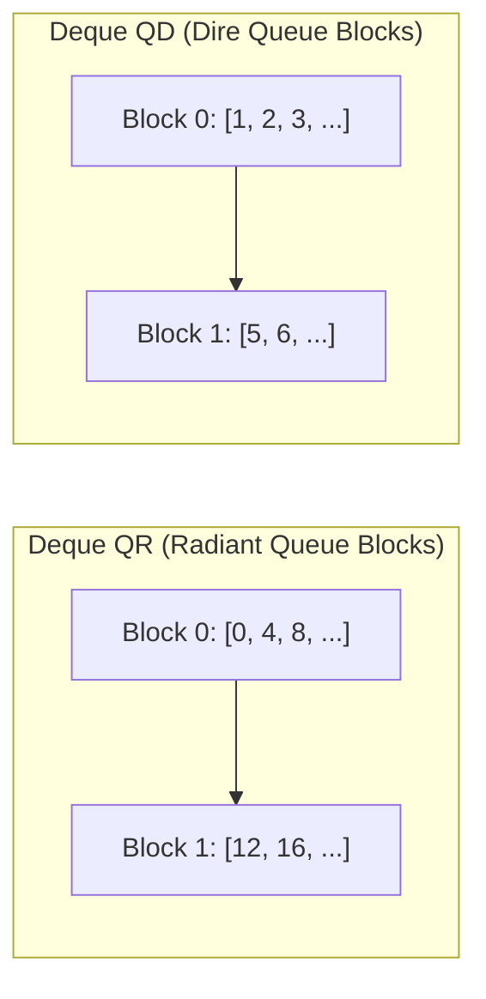
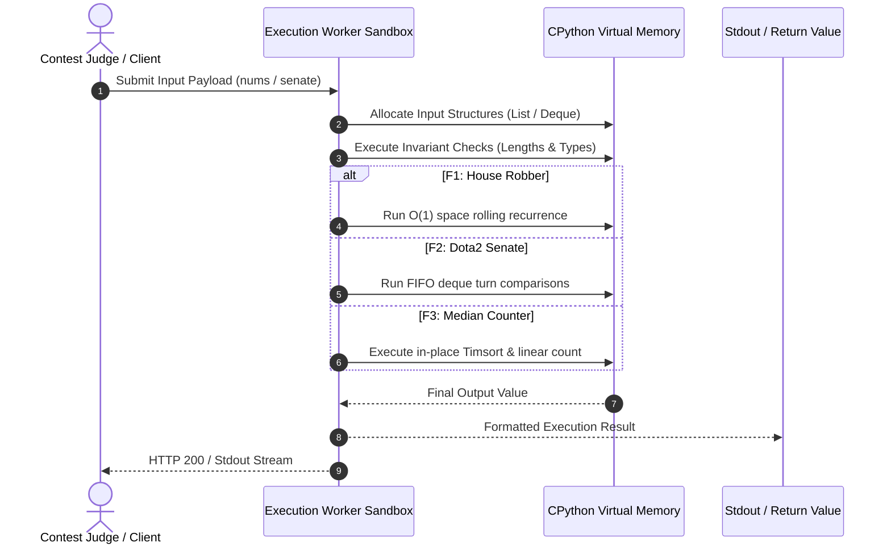

# Architecture & System Design

This document details the high-level architecture of the algorithmic execution engine, memory management lifecycle, data flow diagrams, and how this system scales when embedded into a production distributed code judge.

---

## 1. High-Level System Architecture

In its standalone form, the repository operates as an in-memory computational engine. When deployed to evaluate millions of student and contest submissions, it serves as the core evaluation worker inside a distributed asynchronous execution cluster.



---

## 2. In-Memory Execution & Call Stack Lifecycle

### Feature F1: Dynamic Programming Stack Frame
- **Stack Allocation**: Two 64-bit integer pointer registers (`prev1`, `prev2`) are stored in the local PyFrameObject stack.
- **Cache Locality**: No heap object reallocation occurs during loop execution; integer arithmetic reuses local registers, yielding $L1$ data cache residency.

```mermaid
flowchart LR
    subgraph "CPU Cache / Local Stack Frame"
        P2[Register: prev2]
        P1[Register: prev1]
        CUR[Register: current_max]
    end
    subgraph "Heap Memory (Input Array)"
        ARR["nums[0] ... nums[N-1] (Contiguous PyObject* Array)"]
    end
    ARR -->|Read nums[i]| CUR
    P2 -->|nums[i] + prev2| CUR
    P1 -->|Compare| CUR
    CUR -->|Shift| P1
    P1 -->|Shift| P2
```

---

### Feature F2: Double-Queue Simulation Memory Architecture
- **Deque Structure**: Python's `collections.deque` uses a doubly-linked list of fixed-size blocks (typically 64 elements per block).
- **Invariants**: Pop operations from the head (`popleft()`) deallocate or advance block pointers in $O(1)$ time without shifting elements. Appending to the tail (`append()`) allocates new 64-item blocks only when capacity is exhausted.



---

## 3. Data Flow & Execution Pipeline



---

## 4. Scaling Blueprint to $100\times$ Traffic

If this algorithmic suite experiences a surge from 100 requests per minute to **10,000 requests per second** in an online coding contest:

### Architecture Evolution
1. **Stateless Worker Decoupling**: Isolate the Python execution logic into stateless microservice containers deployed on Kubernetes (EKS/GKE) with horizontal pod autoscaling based on queue length.
2. **Asynchronous Ingestion (BullMQ / Redis)**: Decouple HTTP request handling from algorithm execution. Incoming submissions receive an immediate `202 Accepted` with a job UUID, while worker nodes pull tasks from Redis FIFO queues.
3. **Execution Sandboxing (gVisor / seccomp)**: Wrap each evaluation in a strict sandboxed container with CPU affinity, 256MB RAM ceiling, and a 1-second timeout to prevent CPU monopolization.

### First Three Bottlenecks at Scale
1. **CPython Global Interpreter Lock (GIL) & Process Spawning**: Spawning a new Python process per request incurs a 50ms startup penalty. **Solution**: Maintain a pre-warmed pool of persistent runner daemons communicating via UNIX domain sockets.
2. **Redis Queue Lock Contention**: Under 10,000 jobs/sec, a single Redis master encounters queue lock contention. **Solution**: Shard queue keys across a Redis cluster using consistent hashing.
3. **Memory Bus Saturation during Sorting (Timsort)**: Sorting $10^6$ element arrays concurrently across 32 threads saturates memory bandwidth. **Solution**: Replace full Timsort with QuickSelect to achieve median discovery without array sorting.
