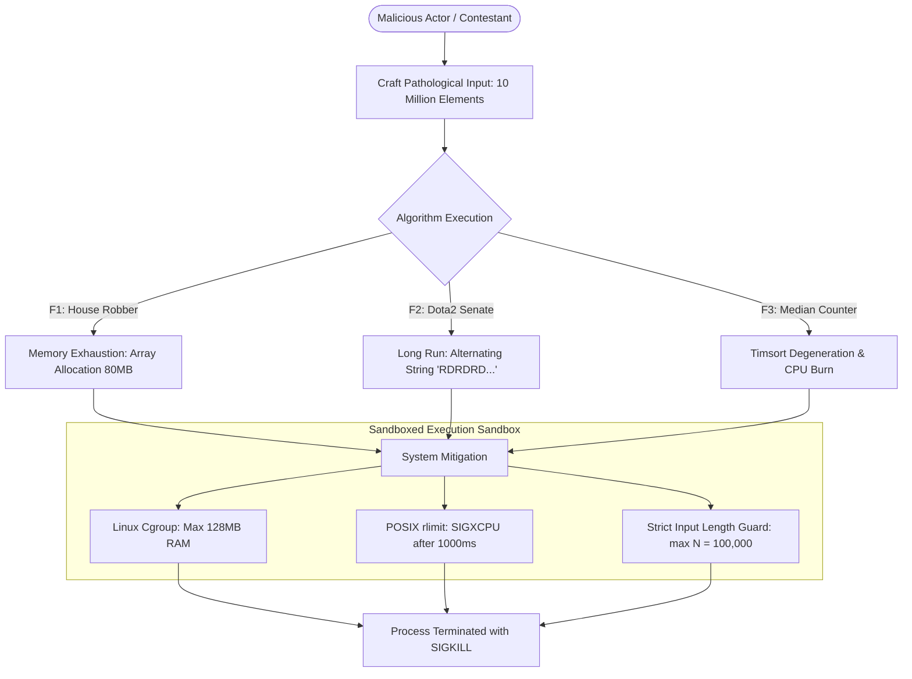

# Security Audit & Threat Modeling (OWASP Analysis)

This document provides a security assessment and vulnerability audit of the algorithmic suite, mapping potential threat vectors against the OWASP Top 10 standards and detailing hardening mitigations for untrusted execution environments.

---

## 1. OWASP Top 10 Vulnerability Audit Matrix

| OWASP Vulnerability Category | Risk Status in Standalone Library | Threat Vector in Online Execution Context | Mitigation Strategy Implemented / Recommended |
| :--- | :--- | :--- | :--- |
| **A01: Broken Access Control** | **Not Applicable** | Unauthorized submission retrieval or contest tampering | Enforce JWT-based RBAC at the API Gateway layer. |
| **A02: Cryptographic Failures** | **Not Applicable** | Sensitive data transmitted in plaintext | Enforce TLS 1.3 encryption across all communication links. |
| **A03: Injection (Code / Command)** | **Low** | Malicious input crafted to trigger `eval()` or OS command execution | **Code Inspection Verified**: No `eval()`, `exec()`, or `os.system()` calls exist in production code. Stdin input is safely parsed using `map(int, input().split())`. |
| **A04: Insecure Design** | **Medium** | Algorithmic Denial of Service (DoS) via pathological inputs | Enforce strict timeouts (1.0s CPU limit) and memory ceilings (256MB) per evaluation. |
| **A05: Security Misconfiguration** | **Low** | Debug flags or unhandled stack traces exposed to clients | Catch exceptions in outer runner and return sanitized error codes (`RUNTIME_ERROR`, `TLE`). |
| **A06: Vulnerable Components** | **None** | Third-party supply chain vulnerabilities | **Zero external dependencies**: Runtime relies exclusively on Python standard library modules. |
| **A07: Identification & Auth Failures** | **Not Applicable** | Credential stuffing on contest judge accounts | Rate-limit login endpoints with Redis sliding window tokens. |
| **A08: Software & Data Integrity** | **Low** | Tampering with test-case inputs or solution binaries | Verify cryptographic SHA-256 hashes of test data prior to evaluation. |
| **A09: Security Logging & Monitoring** | **Medium** | Silent execution failure without audit logs | Log execution metrics (CPU time, memory peak, exit status) with correlation UUIDs. |
| **A10: Server-Side Request Forgery** | **Not Applicable** | Sandbox making unauthorized outbound network requests | Sandbox execution inside network namespaces with `net=none` (zero egress allowed). |

---

## 2. Threat Vector Deep Dive: Algorithmic Denial of Service (DoS)

---

## 3. Sandboxing & Memory Safety Best Practices

When hosting this algorithmic suite on a public online judge or interview assessment platform:

1. **Linux Cgroups & Namespaces**: Execute user submissions inside isolated lightweight containers (e.g., Docker with gVisor `runsc` runtime or Isolate sandbox) with:
   - `pids.max = 32` (Prevents fork bombs).
   - `memory.max = 128M` (Enforces strict OOM bounds).
   - `cpu.max = 100000 100000` (Restricts execution to 1 CPU core).
2. **Network Isolation**: Strip all network interfaces except loopback (`--network none`) to prevent outbound data exfiltration or reverse shell connections.
3. **Seccomp System Call Filtering**: Block privileged Linux syscalls (`ptrace`, `socket`, `clone`, `mount`), permitting only essential standard memory and stream syscalls (`read`, `write`, `exit_group`).
