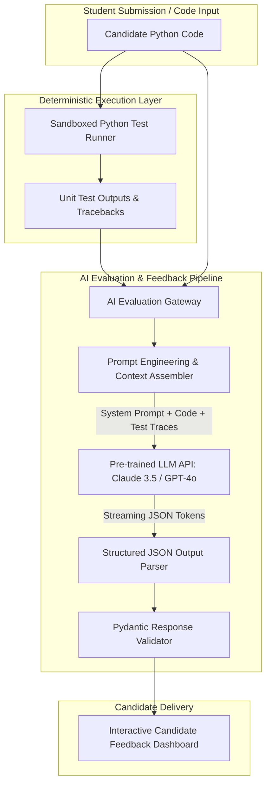

# AI Integration Deep Dive & LLM Evaluation Blueprint

## Current Implementation Status: No AI Integration

In strict accordance with the codebase audit rules:
> **No AI integration is present in the current codebase.** The project is an algorithmic suite and debugging challenge consisting purely of deterministic algorithms implemented in Python standard library code. No pre-trained AI models, LLM APIs, embeddings, or vector databases are imported or invoked.

---

## Architectural Blueprint: Integrating Modern AI for Automated Evaluation

If this algorithmic suite is extended to support an intelligent AI evaluation harness, the following architecture specifies how a pre-trained LLM API (e.g., Anthropic Claude 3.5 Sonnet or OpenAI GPT-4o) should be integrated.



---

## 1. System Prompt & Guardrails Specification

To generate algorithmic hints without leaking complete code solutions, the system prompt employs strict pedagogical constraints:

```text
You are a Senior Staff Algorithm Mentor and Competitive Programming Coach.
Your task is to analyze the candidate's solution against the reference problem statement.

CRITICAL GUARDRAILS:
1. NEVER reveal the complete corrected code.
2. Provide hints incrementally based on the failure category:
   - If Time Limit Exceeded (TLE): Explain the asymptotic difference between O(N) and O(N^2).
   - If Memory Limit Exceeded (MLE): Explain how rolling scalar registers eliminate O(N) array allocation.
   - If Index Out of Bounds: Point to boundary loops and floor division indices.
3. Output MUST be formatted as valid RFC 8259 JSON adhering strictly to the schema provided.
```

---

## 2. Structured Output Schema (Pydantic / JSON Schema)

```json
{
  "$schema": "http://json-schema.org/draft-07/schema#",
  "title": "AlgorithmEvaluationReport",
  "type": "object",
  "properties": {
    "problem_name": { "type": "string" },
    "verdict": { "type": "string", "enum": ["OPTIMAL", "SUBOPTIMAL_COMPLEXITY", "LOGICAL_BUG", "SYNTAX_ERROR"] },
    "detected_time_complexity": { "type": "string" },
    "detected_space_complexity": { "type": "string" },
    "pedagogical_hints": {
      "type": "array",
      "items": { "type": "string" },
      "maxItems": 3
    },
    "edge_cases_missed": {
      "type": "array",
      "items": { "type": "string" }
    }
  },
  "required": ["problem_name", "verdict", "detected_time_complexity", "detected_space_complexity", "pedagogical_hints"]
}
```

---

## 3. Why Use a Pre-Trained API Rather than Training a Custom ML Model

| Dimension | Pre-Trained LLM API (Claude / GPT-4o) | Custom Fine-Tuned Model (Llama-3 8B) | Custom Trained Transformer from Scratch |
| :--- | :--- | :--- | :--- |
| **Upfront Training Cost** | **$0** (Pay-per-token API consumption) | $5,000–$15,000 (GPU cloud rental) | $500,000+ (Massive compute cluster) |
| **Time to Deployment** | **< 1 Day** | 2–4 Weeks | 4–6 Months |
| **Maintenance Burden** | Minimal (Standard HTTP integration) | High (Model weights, vLLM serving infrastructure) | Extreme (Research & ML engineering team) |
| **Reasoning Quality** | State-of-the-art across algorithm code | Moderate (Prone to hallucination on subtle logic) | Low unless billions of tokens trained |
| **Inference Latency** | 500ms–1500ms via HTTP | 150ms–400ms on dedicated GPU | 100ms–200ms |

### Trade-off Conclusion
Training a custom model from scratch is economically and technically unjustifiable for an assessment platform. Utilizing a pre-trained API with structured output parsing delivers superior code reasoning, zero infrastructure overhead, and pay-as-you-go economics.
