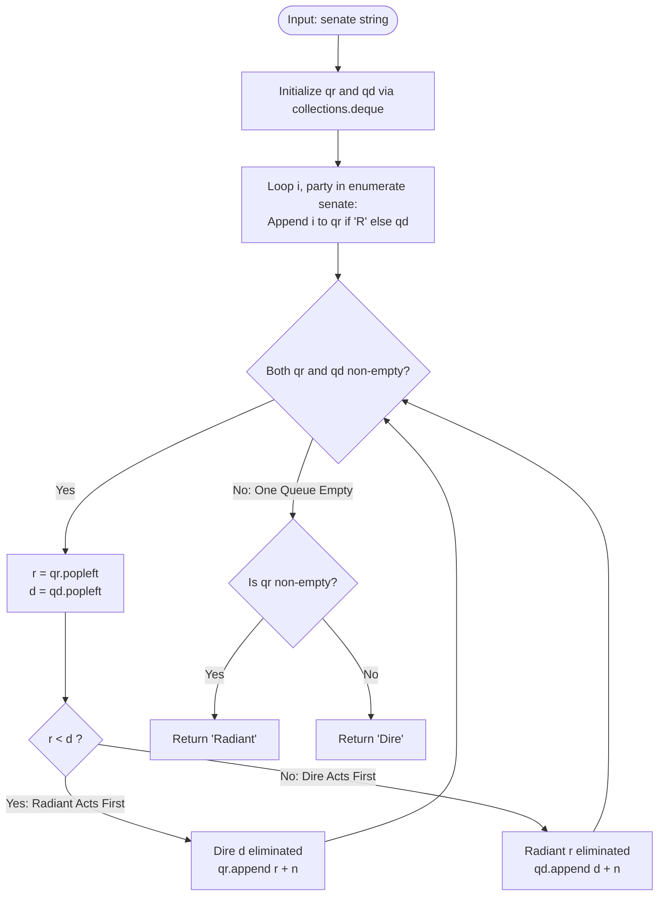
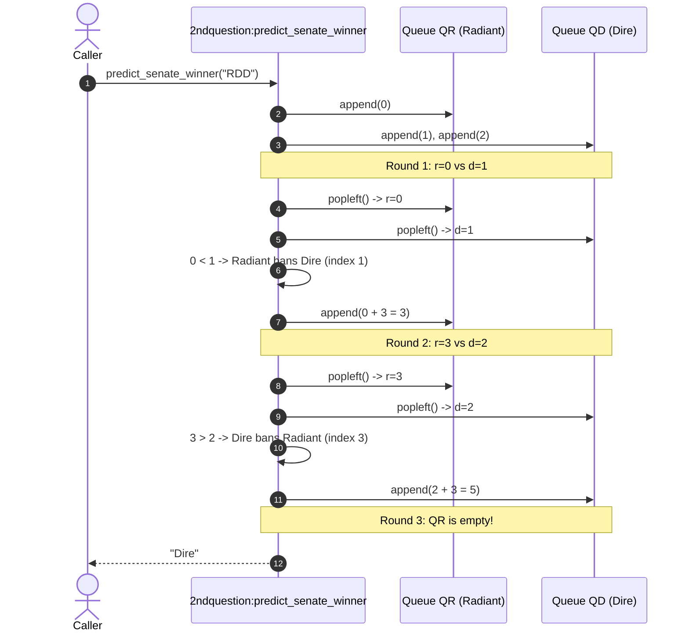
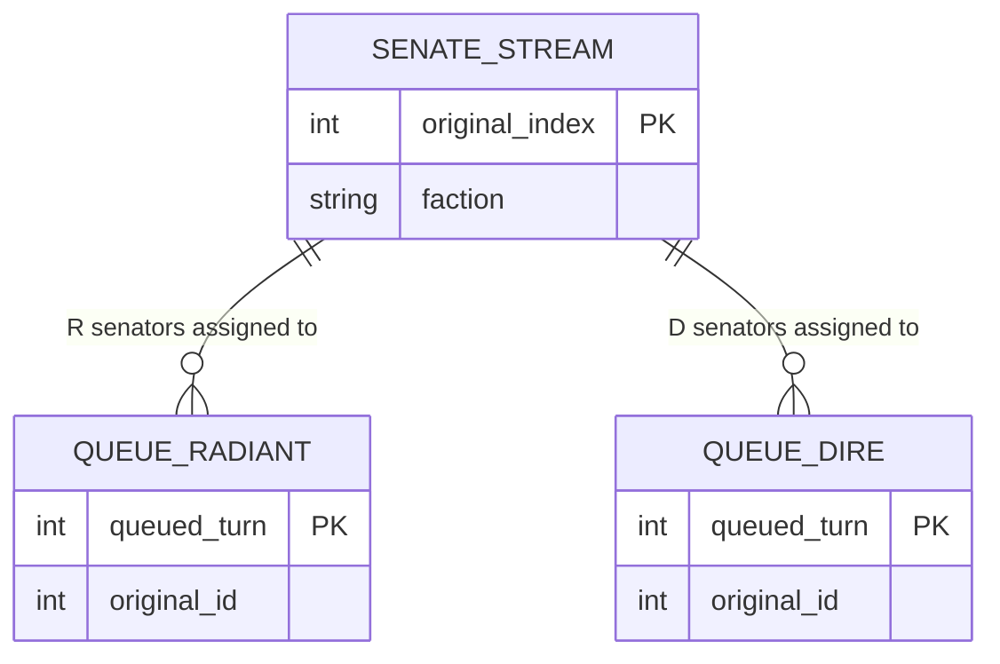
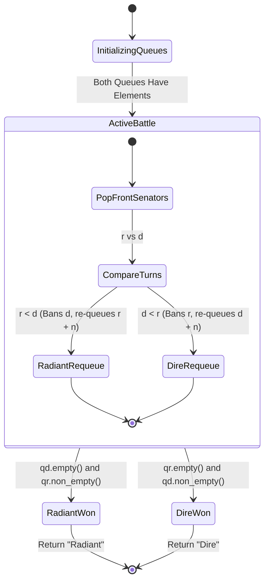
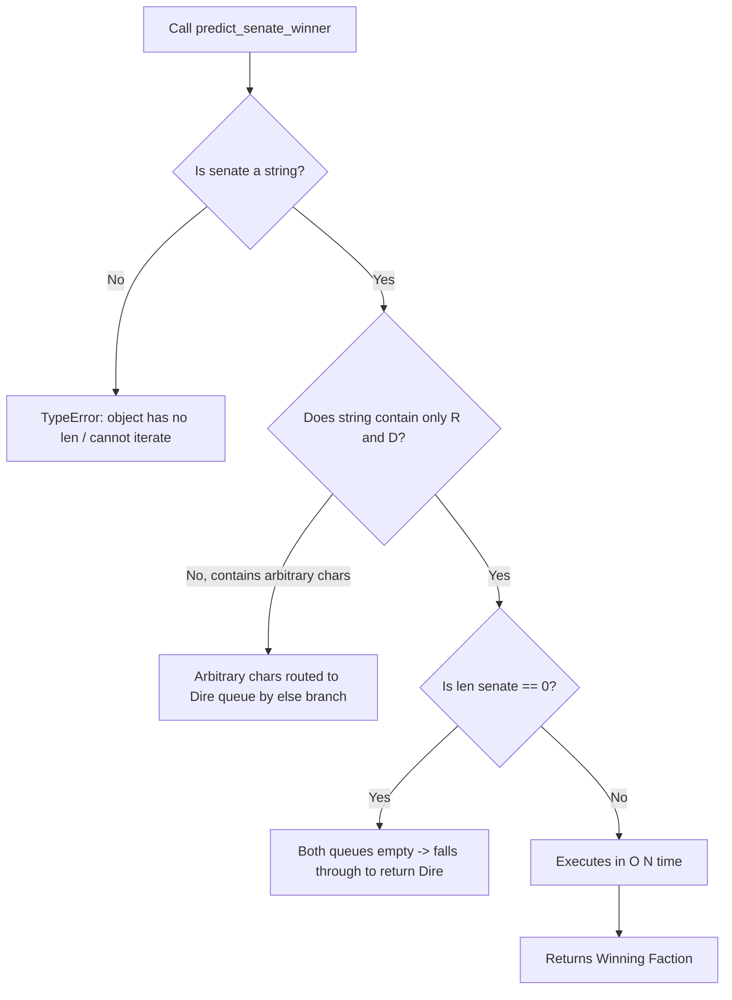

# Feature F2: Dota2 Senate Turn Simulation Engine

## Overview & User-Facing Behavior

Feature F2 implements a game-theoretic simulation for the Dota2 Senate voting procedure (LeetCode 649 / Task 2). The senate consists of senators from two opposing factions: **Radiant** (`'R'`) and **Dire** (`'D'`).

- **Game Rules**:
  - Voting proceeds in rounds in the order that senators appear.
  - A senator can exercise one of two rights:
    1. **Ban an opponent's right**: Choose one senator from the opposing party and eliminate their voting rights for all future rounds.
    2. **Announce victory**: If all remaining senators with voting rights belong to their party, declare victory and conclude the procedure.
  - Senators act with optimal greedy strategy: a senator always bans the *earliest eligible opponent* who would take an action in the current or upcoming rounds, neutralizing the opponent's upcoming ban power.
- **User-Facing Behavior**: Given a string `senate`, returns `"Radiant"` or `"Dire"` indicating which faction ultimately wins.

---

## Technical Specifications & Code References

- **Source File**: [`2ndquestion`](file:///Users/avishjain/avishjain9-repos/57-weatherapp-client/2ndquestion#L1-L26)
- **Primary Function**: `predict_senate_winner(senate: str) -> str`
- **Line-by-Line Code Breakdown**:
  - `Line 1`: `from collections import deque` - Imports double-ended queue primitive supporting $O(1)$ amortized popleft and append.
  - `Line 3`: `def predict_senate_winner(senate: str) -> str:` - Function declaration with type annotations.
  - `Line 4`: `n = len(senate)` - Stores string length $n$ used for circular offset indexing.
  - `Lines 5–6`: `qr = deque(); qd = deque()` - Initializes independent FIFO queues for Radiant and Dire indices.
  - `Lines 8–12`: `for i, party in enumerate(senate):` - Scans input string and populates initial 0-based indices into `qr` or `qd`.
  - `Lines 14–15`: `while qr and qd:` - Execution loop running until one faction is completely eliminated.
  - `Lines 16–17`: `r = qr.popleft(); d = qd.popleft()` - Extracts the earliest active senator from each faction.
  - `Lines 18–21`: Comparison and re-queueing:
    - If `r < d`: Radiant senator acts first, successfully bans Dire senator `d`, and re-enters the voting rotation for the next round at `r + n` (`qr.append(r + n)`).
    - Else (`d < r`): Dire senator acts first, bans Radiant senator `r`, and re-enters at `d + n` (`qd.append(d + n)`).
  - `Lines 23–26`: Final verdict evaluation returning `"Radiant"` if `qr` contains remaining senators, otherwise `"Dire"`.

---

## Mandatory Mermaid Diagrams

### 1. Architectural Flowchart

### 2. Request / Execution Sequence Diagram

### 3. Queue State Data Diagram

### 4. Game State Machine

### 5. Failure-Path & Exception Handling Diagram

---

## Complexity & Invariant Analysis

1. **Greedy Optimality Invariant**: A senator who gets a turn should ban the earliest available opposing senator. Why? An opposing senator whose turn is in the distant future cannot harm the team now; an opposing senator whose turn is *next* is an immediate existential threat. Banning the smallest index is mathematically dominant.
2. **Circular Offset Invariant ($i + n$)**: By adding the total initial count $n$ to the winner's index, the senator is positioned behind all currently living senators for round 2, without requiring array rebuilds or round counters.
3. **Time Complexity**: Each round iteration results in exactly one senator being permanently eliminated. Since there are at most $N$ senators, there can be at most $N$ eliminations. Queue pop and append are $O(1)$. Total runtime is strictly $O(N)$.
4. **Space Complexity**: The two deques hold at most $N$ elements combined at any time, requiring $O(N)$ auxiliary memory.

---

## Say It Out Loud

I implemented this simulation engine to solve the Dota2 Senate problem, which determines which of two political parties wins a multi-round voting battle where each senator can eliminate an opponent's future votes.

When the caller invokes `predict_senate_winner` with a string of senators, my function creates two double-ended queues using Python's `collections.deque`, one for Radiant and one for Dire, and populates them with the zero-based index of each senator. In the main loop, as long as both queues have senators remaining, I pop the front senator from each queue. Whichever senator has the smaller index acted earlier in the round, meaning that senator successfully bans the opponent. The winning senator is then re-queued with their index offset by the length of the string, which places them cleanly at the end of the line for the next round. Once one queue is empty, the party with remaining members is declared the winner.

I chose this double-queue approach with index offsets over array manipulation or linked lists because array deletions take linear time and would degrade the simulation to an unacceptable O(N squared) runtime. With deques, every pop and push operation is constant time, guaranteeing an optimal O(N) linear time and linear space solution.

If an empty string is provided, neither queue populates and it defaults to returning Dire, and passing non-string types raises a TypeError.

One limitation is that any character other than capital R is treated as Dire by the fallback else statement, which in a production environment should be hardened with strict input validation.
