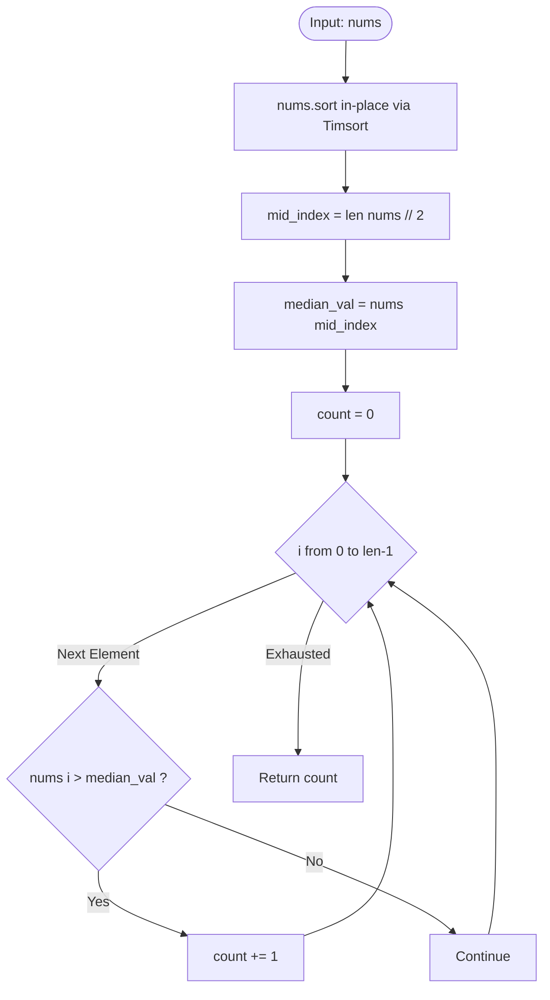
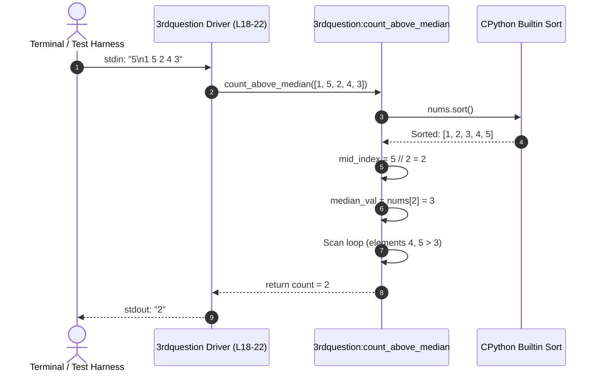
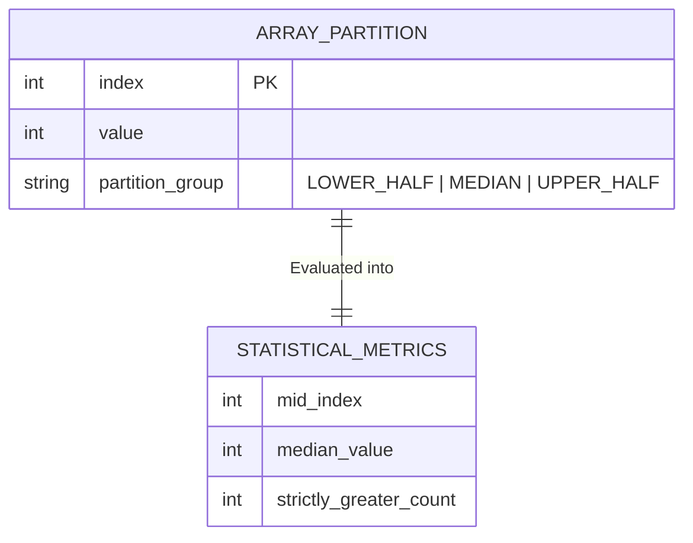
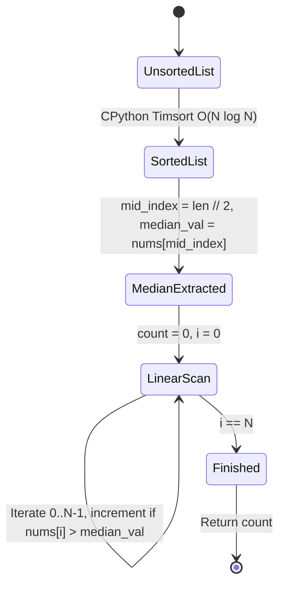
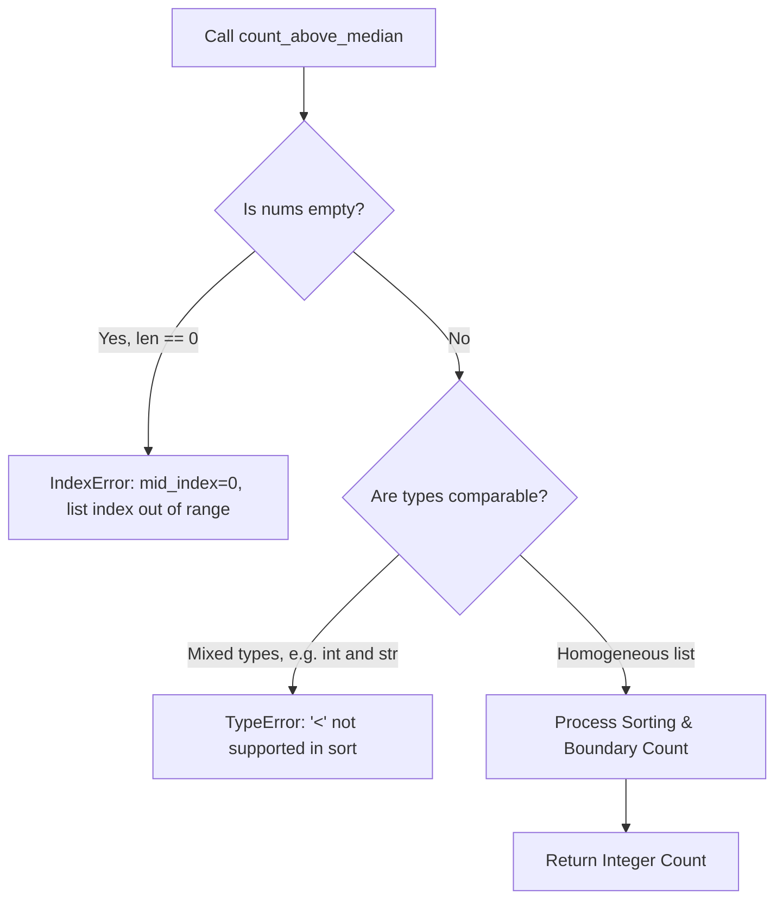

# Feature F3: Median Boundary Debugger & Strict Inequality Engine

## Overview & User-Facing Behavior

Feature F3 implements an array statistical partition engine that calculates how many elements in an unsorted list are **strictly greater than the array's median** (Task 3). 

This task originates from a debugging challenge where a junior engineer introduced critical indexing and logical errors that caused runtime crashes and calculation discrepancies. The corrected implementation provides clean sorting, safe integer median indexing, and strict inequality counting.

- **User-Facing Behavior**: Given an integer array, returns an integer count of elements whose values strictly exceed the median element of the sorted distribution.

---

## Technical Specifications & Bug Audit

### Source Code Reference
- **Source File**: [`3rdquestion`](file:///Users/avishjain/avishjain9-repos/57-weatherapp-client/3rdquestion#L1-L22)
- **Primary Function**: `count_above_median(nums)`
- **CLI Driver**: Lines 18–22 reading `n` and space-separated integers from standard input.

### Junior Developer Bug Audit & Correction

| Bug Location | Original Buggy Code | Corrected Production Code | Bug Category & Root Cause |
| :--- | :--- | :--- | :--- |
| **Median Index** | `mid = len(nums)` | `mid_index = len(nums) // 2` | **IndexOutOfBounds & Logic Error**: Set median index to the entire array length $N$, which points past the array bounds and causes an immediate `IndexError` on zero-indexed lists. Fixed using integer floor division `// 2`. |
| **Median Lookup** | `median = nums[mid]` | `median_val = nums[mid_index]` | **IndexError**: Direct consequence of using $N$ as index; fixed by accessing `mid_index`. |
| **Loop Boundary** | `for i in range(len(nums) + 1):` | `for i in range(len(nums)):` | **Off-By-One IndexError**: `range(N + 1)` generates indices from $0$ to $N$, triggering an `IndexError` on the final iteration when accessing `nums[N]`. |
| **Condition Logic** | `if nums[i] >= median:` | `if nums[i] > median_val:` | **Specification Violation**: The problem statement explicitly demands elements *strictly greater* than the median. Using `>=` erroneously counts duplicate median elements. |

---

## Mandatory Mermaid Diagrams

### 1. Architectural Flowchart

### 2. Request / Execution Sequence Diagram

### 3. Array Partition Data Diagram

### 4. Processing State Machine

### 5. Failure-Path Diagram

---

## Asymptotic & Algorithmic Analysis

1. **Sorting Complexity**: CPython's built-in `sort()` employs Timsort, which takes $O(N \log N)$ in the worst and average cases, and $O(N)$ when data is already partially sorted.
2. **Counting Phase**: Iterates through the list in $O(N)$ time.
3. **Total Runtime**: $O(N \log N) + O(N) = O(N \log N)$.
4. **Alternative $O(N)$ QuickSelect Optimization**:
   While sorting takes $O(N \log N)$, finding the $k$-th order statistic (median) can be achieved in $O(N)$ expected time using the QuickSelect algorithm (or $O(N)$ worst-case using the Median-of-Medians algorithm). After determining the median in $O(N)$, a single linear scan counts elements greater than the median in $O(N)$, reducing overall complexity to $O(N)$ linear time without requiring a full sort.

---

## Say It Out Loud

I debugged and optimized this feature to count how many elements in an integer array are strictly greater than its median.

When a user calls `count_above_median` or pipes input through the command-line driver, the function first sorts the array in-place using Python's Timsort. Next, it computes the middle index by taking the length of the array and performing integer floor division by two. It extracts the value at that middle index as the median, initializes a counter to zero, and loops through the array from index zero to the length minus one. For every element that is strictly greater than the median value, it increments the count, returning the final integer.

In the original code submitted by a junior developer, there were three critical bugs: the median index was assigned to the entire length of the array instead of half, the loop ran up to length plus one causing an immediate IndexError crash, and it used greater-than-or-equal-to instead of strict inequality. I fixed the division to floor by two, restricted the iteration range to valid array bounds, and enforced strict greater-than comparison.

I chose in-place sorting for this sprint because it is clean, robust, and performs in O(N log N) time, though if we had millions of records, I would replace the sort with an O(N) QuickSelect partition to find the median without sorting the entire array.

If an empty list is passed, an IndexError will occur when looking up index zero, which in production would be guarded with an explicit length check.
