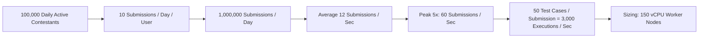

# 14.1 Requirements & Capacity Estimation

This chapter establishes the functional and non-functional requirements and mathematical capacity sizing required to scale the in-memory algorithm suite into a production online judge platform.

---

## 1. What It Is in Plain Words
Requirements definition and capacity estimation represent the engineering discipline of translating user product needs into concrete, quantified computational budgets—calculating requests per second (QPS), bandwidth, memory capacity, and database storage over a multi-year horizon before writing infrastructure code.

---

## 2. Whether and How THIS Project Uses It
In the local workspace, the project runs as a single-process local Python script with interactive CLI or module import. Inputs are modest ($N \le 100$ in `task1.md`, strings of length $\le 10^4$ in `task2.md`), executing in $< 1\text{ ms}$ with negligible RAM footprint ($< 15\text{ MB}$). Formal capacity estimation was not necessary for the sprint prototype [CONFIRM WITH DEVELOPER].

---

## 3. Scale-Out Architecture Requirements

### Functional Requirements
1. **Submission Ingestion**: Allow contestants to submit solutions for House Robber, Dota2 Senate, and Median problems.
2. **Automated Sandboxed Evaluation**: Compile and execute submitted code against a test battery of 50 test cases per problem.
3. **Verdict Generation**: Output immediate verdicts: `Accepted (AC)`, `Wrong Answer (WA)`, `Time Limit Exceeded (TLE)`, `Memory Limit Exceeded (MLE)`, or `Runtime Error (RTE)`.
4. **Live Leaderboard**: Compute contest rankings and scores in real time based on test-case passes and submission latency.

### Non-Functional Requirements
1. **Low Evaluation Latency**: p95 submission grading turnaround time $< 2.5\text{ seconds}$.
2. **Strict Multi-Tenant Sandboxing**: Prevent submitted code from executing arbitrary OS system calls, exfiltrating data, or exhausting host resources.
3. **High Availability**: $99.95\%$ uptime during active 4-hour programming contests.
4. **Consistency**: Zero race conditions in score calculation or submission ordering.

---

## 4. Capacity Estimation & Mathematical Sizing

### 1. Traffic Estimates (Throughput & QPS)
- **Daily Active Users (DAU)**: $100,000$ contestants during global hackathons.
- **Submissions per User**: Average of $10$ submissions per day.
- **Total Daily Submissions**: $100,000 \times 10 = 1,000,000\text{ submissions/day}$.
- **Average QPS**:
  $$\text{Average QPS} = \frac{1,000,000\text{ submissions}}{86,400\text{ seconds}} \approx 11.6\text{ submissions/second}$$
- **Peak Traffic Multiplier**: During the start and final 15 minutes of a contest, traffic spikes $5\times$:
  $$\text{Peak QPS} = 11.6 \times 5 \approx 58\text{ submissions/second} \approx 60\text{ QPS}$$
- **Test-Case Executions**: Each submission runs across $50$ test cases:
  $$\text{Peak Execution QPS} = 60\text{ submissions/sec} \times 50\text{ tests} = 3,000\text{ test executions/second}$$

### 2. Compute & Worker Sizing
- Average execution duration per test case: $50\text{ ms} = 0.05\text{ s}$.
- Total concurrent execution time demanded at peak:
  $$3,000\text{ executions/sec} \times 0.05\text{ s} = 150\text{ core-seconds/second}$$
- **Worker CPU Requirement**: 150 dedicated vCPUs. Sizing with a $50\%$ headroom buffer yields **$225\text{ vCPUs}$** across the worker pool (e.g., $14\times$ `c6i.4xlarge` AWS EC2 instances with 16 vCPUs each).

### 3. Storage & Bandwidth Estimation
- Average source code submission size: $5\text{ KB}$.
- Average execution log and stdout output: $15\text{ KB}$.
- Total payload per submission: $20\text{ KB}$.
- **Daily Storage Growth**:
  $$1,000,000\text{ submissions/day} \times 20\text{ KB} = 20,000,000\text{ KB} \approx 20\text{ GB/day}$$
- **Annual Storage Growth**:
  $$20\text{ GB/day} \times 365 \approx 7.3\text{ TB/year}$$
- **Network Ingress Bandwidth at Peak**:
  $$60\text{ submissions/sec} \times 20\text{ KB} = 1,200\text{ KB/s} \approx 9.6\text{ Mbps}$$

---

## 5. What Breaks First Across Scaling Orders

| Load Multiple | Traffic Level | Primary Failure Point | Root Cause & Bottleneck | Remediation |
| :--- | :--- | :--- | :--- | :--- |
| **$10\times$** | $600\text{ exec/s}$ | Synchronous HTTP connection timeouts | Web API threads block waiting for Python sandboxes to finish | Move to asynchronous Redis BullMQ job queues |
| **$100\times$** | $6,000\text{ exec/s}$ | Linux process fork limits & PID exhaustion | Spawning fresh Python sub-processes exhausts host OS PIDs | Maintain warm pre-forked worker pools in gVisor sandboxes |
| **$1,000\times$** | $60,000\text{ exec/s}$ | Redis queue lock contention & network saturation | Single Redis master cannot sustain 60k pop/push ops | Shard queues across Redis Cluster with consistent hashing |

---

## 6. 30-Second Interview Answer
> "In designing the system for scale, I estimated that 100,000 active contestants generate 1 million submissions daily. Factoring in a 5x peak burst and 50 test cases per submission, our execution engine must sustain 3,000 test runs per second. With an average 50ms run time, Little's Law dictates that we need 150 concurrent execution slots, which translates to roughly 14 cloud worker nodes with 225 vCPUs, backed by asynchronous Redis queuing to absorb traffic spikes without dropping connections."
