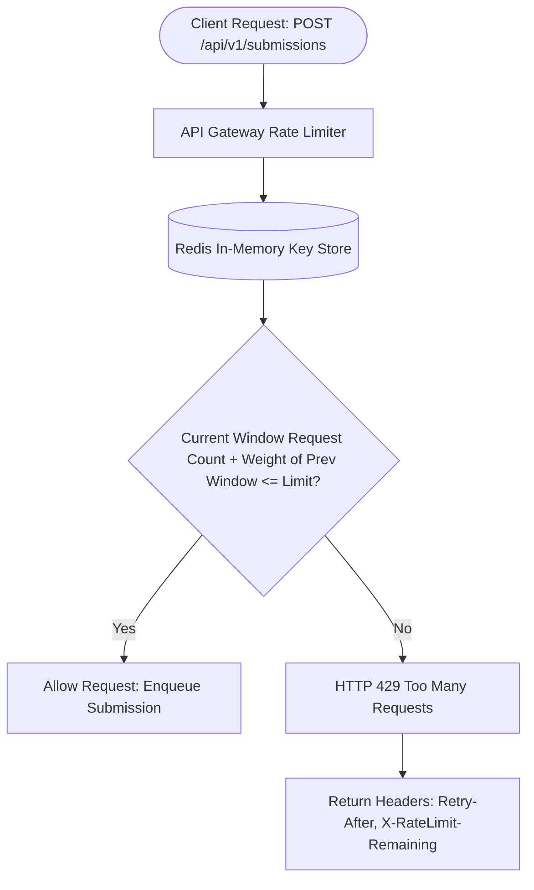

# 14.10 API Design, Versioning & Rate Limiting Algorithms

This chapter defines the public REST API contracts, idempotent submission headers, pagination strategies, and rate limiting algorithms used to prevent denial-of-service abuse.

---

## 1. What It Is in Plain Words
API design establishes the contract through which external clients consume server resources, while rate limiting restricts the frequency of requests any single client or IP can issue, protecting the platform from abuse.

---

## 2. Sliding Window Counter Rate Limiting Flow



---

## 3. Rate Limiting Algorithm Comparison

| Algorithm | Mechanism | Memory Footprint | Accuracy Under Window Boundaries | Burst Tolerance | Fit in Online Judge |
| :--- | :--- | :--- | :--- | :--- | :--- |
| **Fixed Window Counter** | Counter resets at fixed clock interval (e.g. 12:00, 12:01) | **Minimal (1 integer/key)** | **Poor** (Double burst allowed across window edges) | High (Bursty) | Suboptimal |
| **Sliding Window Log** | Stores timestamp of every request in sorted set | **Extreme** (1 log entry per request) | Perfect (Exact to millisecond) | Controlled | Too expensive at scale |
| **Sliding Window Counter (Selected)** | Blends current window count with weighted previous window | **Minimal (2 keys per user)** | **High (Smooth rolling estimation)** | Controlled | **Optimal for API Endpoints** |
| **Token Bucket** | Tokens added at fixed rate; request consumes 1 token | Low (2 values: tokens, timestamp) | High | **Excellent (Allows configured bursts)** | **Optimal for Submission Throttling** |
| **Leaky Bucket** | Requests enter queue; drained at constant rate | Low (Queue buffer) | High | Zero (Smooths output strictly) | Good for traffic shaping |

---

## 4. Production API Specification

### Endpoint: Create Submission
- **Method**: `POST`
- **Path**: `/api/v1/contests/{contest_id}/submissions`
- **Headers**:
  - `Authorization: Bearer <jwt_token>`
  - `Idempotency-Key: <uuidv4>`
- **Request Body**:
  ```json
  {
    "problem_slug": "house-robber",
    "language": "python3",
    "source_code": "def house_robber(nums):\n    ..."
  }
  ```
- **Response**: `202 Accepted`
  ```json
  {
    "submission_id": "7c9e6679-7425-40de-944b-e07fc1f90ae7",
    "status": "QUEUED",
    "websocket_stream_url": "wss://judge.acme.com/ws/submissions/7c9e6679"
  }
  ```

---

## 5. What Breaks First Across Scaling Orders
- **$10\times$ Load**: Rate limiter Redis keys without TTLs, slowly leaking memory over months.
- **$100\times$ Load**: Cursor pagination required on submission history; standard SQL `OFFSET` degrades to $O(N)$ table scans on millions of rows.
- **$1,000\times$ Load**: API gateway CPU saturated executing Lua scripts for rate limiting across 100,000 QPS. **Fix**: Move rate limiting to Edge CDN (Cloudflare Rate Limiting Rules).

---

## 6. 30-Second Interview Answer
> "We design our API around clean REST conventions with HTTP/2 and explicit idempotency keys on all submission endpoints. For rate limiting, we combine two algorithms: a Token Bucket at the user level to allow controlled bursts of submissions while capping sustained traffic to 1 submission every 5 seconds, and a Sliding Window Counter at the IP level to prevent distributed credential stuffing and DoS attacks."
