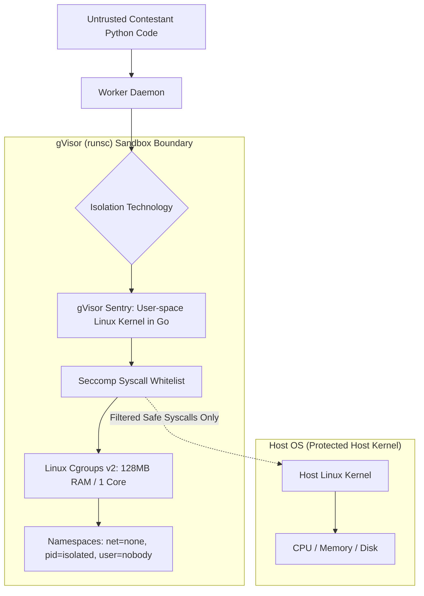

# 14.11 Security Architecture & Sandboxed Code Execution

This chapter specifies the multi-tenant isolation sandbox, kernel attack surface reduction, and privilege separation required to execute untrusted user code safely.

---

## 1. What It Is in Plain Words
Security architecture in a code execution environment ensures that untrusted programs submitted by arbitrary internet users can be executed without compromising host integrity, accessing adjacent tenants' data, or monopolizing hardware resources.

---

## 2. Multi-Tenant Execution Sandbox Architecture

---

## 3. Sandboxing Technology Comparison

| Sandbox Technology | Isolation Boundary | Startup Latency | Memory Overhead | Defense-in-Depth Rating | Fit for Code Judge |
| :--- | :--- | :--- | :--- | :--- | :--- |
| **Raw Chroot / Jail** | Filesystem namespace only | **< 1ms** | **Zero** | **Extremely Poor (Trivial root breakout)** | Unacceptable |
| **Standard Docker (`runc`)** | Namespaces + Cgroups | 50–150ms | Low | Moderate (Shares host kernel; kernel bugs compromise host) | Risky |
| **gVisor `runsc` (Selected)** | **User-Space Kernel (Intercepts all syscalls)** | **20–50ms** | **Low (~15MB)** | **Ultra-High (Kernel attacks contained in user-space)** | **Optimal Standard** |
| **Firecracker MicroVMs** | Hardware Virtualization (KVM) | 5–15ms | Moderate (~5MB RAM per VM) | **Ultra-High (Hardware isolated)** | High (Best for heavy tasks) |
| **WebAssembly (Wasmtime)** | Software Fault Isolation (WASM bytecode) | < 1ms | Ultra-Low | Very High | Requires compiling Python to WASM |

---

## 4. Kernel Attack Surface Reduction & Syscall Filtering
Untrusted Python code submitted for House Robber or Dota2 Senate requires only standard computation, memory manipulation, and basic stdout streams. It has no legitimate reason to invoke network sockets, process cloning, or raw disk mounts.
- **Seccomp Whitelist**: We enforce a strict Seccomp BPF filter that permits only 12 essential Linux system calls: `read`, `write`, `exit`, `exit_group`, `futex`, `brk`, `mmap`, `munmap`, `mprotect`, `rt_sigaction`, `rt_sigreturn`, `gettimeofday`.
- All other system calls (e.g., `socket`, `connect`, `clone`, `fork`, `execve`) return `EPERM`, terminating malicious attempts immediately.

---

## 5. What Breaks First Across Scaling Orders
- **$10\times$ Load**: Uncleaned `/tmp` mounts filling local worker disk over days.
- **$100\times$ Load**: Inode exhaustion if millions of small temporary source files are written to disk. **Fix**: Use in-memory `tmpfs` mounts.
- **$1,000\times$ Load**: Context switching overhead between gVisor Sentry and host kernel under 10,000 concurrent containers.

---

## 6. 30-Second Interview Answer
> "Running untrusted student code requires defense-in-depth: standard Docker containers share the host Linux kernel, leaving them vulnerable to privilege escalation. We use Google's gVisor `runsc` runtime, which intercepts all system calls in a user-space Go kernel. Backed by Cgroups v2 for hard memory and CPU quotas, Seccomp syscall whitelisting, and completely disabled networking, an attacker cannot break out of the container even if they execute malicious exploits."
