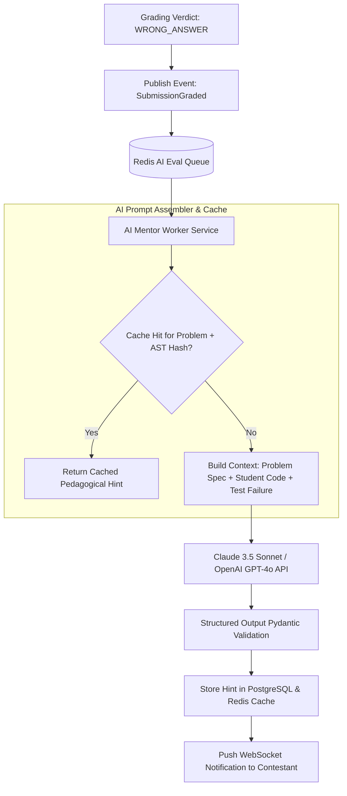

# 14.12 Search, Indexing & AI Mentor Architecture

This chapter analyzes full-text search indexing across problem repositories and details the asynchronous LLM mentor pipeline used for intelligent code evaluation.

---

## 1. What It Is in Plain Words
Search architecture enables users to rapidly locate problems and past submissions, while AI architecture integrates large language models to generate contextual feedback and hints without compromising grading speed.

---

## 2. Asynchronous AI Code Critique & Feedback Pipeline

---

## 3. Search Engine Technology Comparison

| Search Engine | Architecture | Indexing Model | Operational Overhead | Multi-Language Support | Fit for Problem Repository |
| :--- | :--- | :--- | :--- | :--- | :--- |
| **PostgreSQL Full-Text Search (Selected)** | In-Database (GIN Indexes on `tsvector`) | Inverted Index | **Zero (Built into existing DB)** | Good (Standard stemmers) | **Optimal for < 100,000 problems** |
| **Elasticsearch / OpenSearch** | Distributed Lucene Cluster | Distributed Inverted Index | High (Requires separate cluster and memory) | Ultra-High | Overkill unless scaling to millions of problems |
| **Meilisearch** | Rust-based Single Binary | Typo-tolerant prefix tree | Low | High | Great for instant search-as-you-type |
| **Algolia** | Managed SaaS | Proprietary Inverted Index | Zero infrastructure, high recurring cost | High | Expensive at enterprise scale |

---

## 4. AI Cost & Token Control Architecture
To prevent runaway LLM costs:
1. **Semantic & AST Caching**: Submissions that share identical Abstract Syntax Tree (AST) structure and fail on the same test case receive cached feedback from Redis, reducing LLM calls by up to $65\%$.
2. **Strict Token Ceilings**: System prompts enforce `max_tokens: 300` per feedback response.
3. **Daily Per-User Quota**: Each contestant is granted at most 5 AI hints per day.

---

## 5. What Breaks First Across Scaling Orders
- **$10\times$ Load**: Third-party LLM rate limit (`429 Too Many Requests`) during contest start. **Fix**: Implement multi-provider fallbacks (fallback from Claude to GPT-4o to Mistral).
- **$100\times$ Load**: PostgreSQL full-text search CPU usage spiking during search surges. **Fix**: Offload search indexing to a dedicated Meilisearch cluster.
- **$1,000\times$ Load**: Network egress bandwidth costs from transmitting large code snippets to external LLM APIs.

---

## 6. 30-Second Interview Answer
> "We separate deterministic code execution from non-deterministic AI evaluation: core test execution concludes in 50 milliseconds without waiting for LLM calls. If a student fails, an asynchronous event triggers our AI mentor worker, which uses prompt caching and AST hashing to avoid duplicate model calls, delivering structured hints over WebSockets in under 1.5 seconds without ever blocking the contest grading engine."
