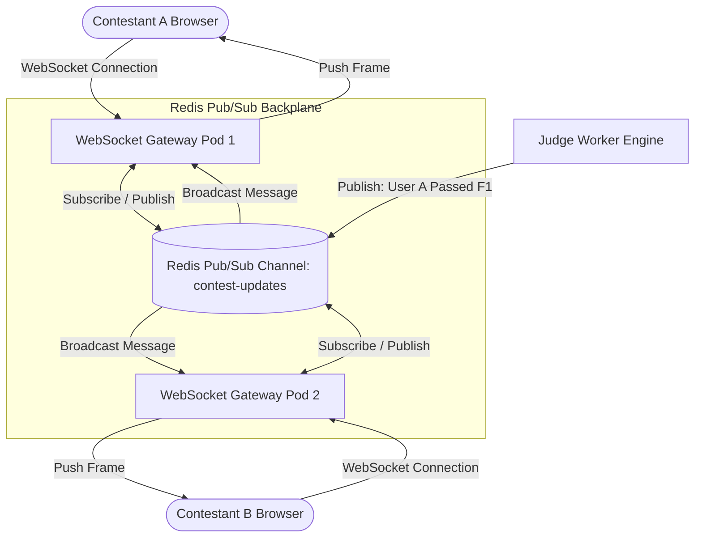

# 14.13 Real-Time Systems & WebSocket Scaling

This chapter analyzes real-time streaming architectures, pub/sub backplanes, connection scaling, and presence tracking for live contest environments.

---

## 1. What It Is in Plain Words
Real-time architecture establishes persistent, bi-directional network pipes between clients and servers, pushing instant updates (such as test execution passes and leaderboard movements) without requiring clients to poll.

---

## 2. Horizontal WebSocket Cluster with Redis Pub/Sub Backplane



---

## 3. Real-Time Transport Protocols Comparison

| Protocol | Connection Type | Directionality | Server Memory Footprint | Reconnection Handling | Fit in Contest System |
| :--- | :--- | :--- | :--- | :--- | :--- |
| **Short Polling** | Standard HTTP/1.1 | Client $\to$ Server | None (Stateless) | Inherent | **Poor (Drowns server in 100k QPS empty polls)** |
| **Long Polling** | Held HTTP Request | Client $\to$ Server | High (Blocks server sockets) | Inherent | Suboptimal |
| **Server-Sent Events (SSE)** | Persistent HTTP/2 | Server $\to$ Client (Unidirectional) | Low | Built-in browser reconnection | Good for read-only score feeds |
| **WebSockets (Selected)** | Upgraded TCP Socket | **Full-Duplex Bi-directional** | **Low (~10KB/connection)** | Handled via heartbeat ping/pong | **Optimal for Interactive Live Feedback** |

---

## 4. Connection Scaling to 100,000 Concurrent WebSockets
1. **Linux Epoll Tuning**: Increase open file descriptor limits on WebSocket proxy nodes:
   ```text
   fs.file-max = 2097152
   ulimit -n 1048576
   ```
2. **Horizontal Distribution**: 100,000 connections distributed across 10 WebSocket gateway nodes (10,000 connections per pod) requiring only 100MB of RAM overhead per pod.
3. **Heartbeat & Dead Connection Pruning**: Clients and servers exchange `PING`/`PONG` frames every 30 seconds. Connections missing two consecutive heartbeats are forcibly closed to free socket handles.

---

## 5. What Breaks First Across Scaling Orders
- **$10\times$ Load**: Epoll socket starvation on single gateway instance.
- **$100\times$ Load**: Redis Pub/Sub broadcast saturation if 100,000 clients all receive individual notifications. **Fix**: Aggregate score updates and broadcast batched ticks once per second.
- **$1,000\times$ Load**: TCP socket buffer memory exhausting kernel RAM. **Fix**: Tune `net.ipv4.tcp_rmem` and `net.ipv4.tcp_wmem` buffer sizes.

---

## 6. 30-Second Interview Answer
> "We power live grading updates using WebSockets distributed across a cluster of stateless gateway nodes backed by a Redis Pub/Sub message backplane. When an execution worker finishes grading a problem, it publishes a compact binary event to Redis. The backplane fans the message out to the specific gateway pod holding the user's active socket, delivering real-time feedback with under 10 milliseconds of latency."
