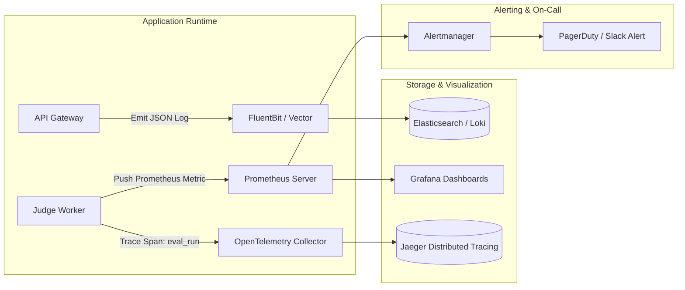

# 14.14 Observability, Telemetry & SRE Operations

This chapter defines the three pillars of observability—metrics, structured logs, and distributed tracing—alongside automated CI/CD deployments and alert thresholds.

---

## 1. What It Is in Plain Words
Observability provides end-to-end visibility into internal system health and behavior through external telemetry signals, enabling engineers to detect, isolate, and resolve production failures before users report them.

---

## 2. Distributed Telemetry Pipeline

---

## 3. Observability Tools Comparison

| Telemetry Pillar | Tool / Framework | Data Model | Retention Policy | Primary Operational Value |
| :--- | :--- | :--- | :--- | :--- |
| **Metrics** | **Prometheus + Grafana (Selected)** | Time-series multidimensional counters & histograms | 30 Days | **Real-time worker CPU, queue depth, TLE rates** |
| **Distributed Tracing** | **OpenTelemetry + Jaeger (Selected)**| Trace spans with correlation UUIDs | 7 Days (Sampled 10%) | **End-to-end submission latency breakdown** |
| **Structured Logging** | **Vector + Grafana Loki (Selected)** | JSON logs indexed by stream labels | 14 Days | **Root-cause error diagnosis and audit trail** |
| **Error Tracking** | **Sentry** | Exception stack traces & breadcrumbs | 30 Days | **Unhandled worker sandbox crashes & bug isolation** |

---

## 4. Key Metrics & Alert Thresholds
1. **Submission Queue Depth**: Alerts if BullMQ pending jobs exceed $1,000$ for $> 60\text{ seconds}$ (Trigger: Worker scaling issue).
2. **Worker TLE Spike Rate**: Alerts if Time Limit Exceeded verdicts spike above $30\%$ across all submissions (Trigger: Potential infinite loop or CPU throttling).
3. **API Gateway p99 Latency**: Alerts if HTTP response time exceeds $1.5\text{ seconds}$ over a 5-minute rolling window.

---

## 5. What Breaks First Across Scaling Orders
- **$10\times$ Load**: High cardinality in Prometheus metrics (e.g., adding user ID as a metric label causes memory ballooning). **Fix**: Strip high-cardinality labels from Prometheus; send them to logs.
- **$100\times$ Load**: Log volume exceeding disk capacity (1 million submissions generating 20GB of logs/day). **Fix**: Sample trace spans at $5\%$ and aggregate worker logs.
- **$1,000\times$ Load**: Centralized logging ingestion bottleneck; requires distributed partitioning via Kafka before Loki ingestion.

---

## 6. 30-Second Interview Answer
> "We monitor the platform through the three pillars of observability: Prometheus collects dimensional time-series metrics on queue depth, sandbox CPU usage, and verdict distributions; OpenTelemetry injects correlation IDs to trace each submission from API gateway to worker; and structured JSON logs are indexed in Loki. If the queue depth exceeds 1,000 jobs or the p99 latency spikes above 1.5 seconds, Alertmanager immediately pages the on-call engineer via PagerDuty."
