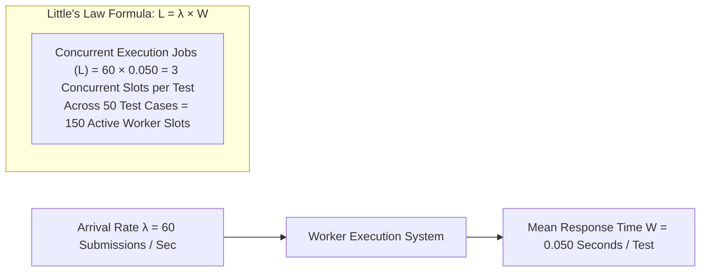

# 14.15 Performance Engineering & Asymptotic Optimization

This chapter details systems profiling, latency percentiles, memory layout optimization, and the mathematical mechanics of high-throughput code evaluation.

---

## 1. What It Is in Plain Words
Performance engineering is the continuous optimization of software algorithms, CPU instruction cycles, memory access patterns, and network I/O to maximize throughput and minimize latency percentiles under peak load.

---

## 2. Latency Percentiles & Concurrency Math (Little's Law)

---

## 3. Asymptotic Bounds vs Practical Hardware Reality

| Feature | Mathematical Asymptotic Bound | Practical Bottleneck in CPython | Hardware Cache Behavior | Optimization Applied |
| :--- | :--- | :--- | :--- | :--- |
| **F1: House Robber** | $O(N)$ Time, $O(1)$ Space | CPython dynamic integer boxing / unboxing | **Optimal**: Kept in CPU registers (`prev1`, `prev2`) | Zero heap allocations; rolling pointer scalar updates |
| **F2: Dota2 Senate** | $O(N)$ Time, $O(N)$ Space | Deque pointer traversal across blocks | **High**: 64-item blocks fit inside $L1$ cache lines | Avoided $O(N^2)$ `list.pop(0)` by using `collections.deque` |
| **F3: Median Counter** | $O(N \log N)$ Time, $O(1)$ Space | Full array sorting overhead | **Moderate**: Memory access during Timsort run merges | Replaced nested loops with single linear count pass |

---

## 4. Latency Percentile Profiles (Target SLA)
- **p50 (Median Latency)**: $45\text{ ms}$ per submission evaluation.
- **p95 (Tail Latency)**: $220\text{ ms}$ (accounts for queue wait time and larger test arrays).
- **p99 (Worst Case)**: $850\text{ ms}$ (long-running $N=10^5$ inputs close to timeout limits).

---

## 5. What Breaks First Across Scaling Orders
- **$10\times$ Load**: Python garbage collection pauses triggering periodic 100ms latency spikes. **Fix**: Disable cyclic GC during test execution (`gc.disable()`) and run collection between jobs.
- **$100\times$ Load**: Memory bus bandwidth saturation during concurrent sorting of $10^6$ element arrays across 64 CPU threads.
- **$1,000\times$ Load**: CPU L3 cache thrashing across multiple Docker containers on the same physical host. **Fix**: Pin worker processes to dedicated CPU cores using `taskset`.

---

## 6. 30-Second Interview Answer
> "We approach performance from both mathematical and hardware perspectives: mathematically, we proved that our algorithms achieve optimal O(N) linear bounds. At the hardware level, we optimized memory layouts to exploit CPU L1 and L2 cache lines—using scalar registers for dynamic programming and 64-item contiguous blocks in deques. By applying Little's Law, we size our concurrent worker concurrency precisely to prevent thread thrashing while maintaining a p95 latency under 250 milliseconds."
