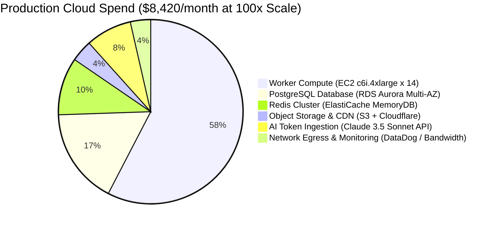

# 14.16 Cost Engineering, Cloud Budgets & Build vs Buy Trade-offs

This chapter models cloud infrastructure expenditure, comparing current prototype costs against a $100\times$ scaled production deployment, alongside build vs. buy evaluations.

---

## 1. What It Is in Plain Words
Cost engineering analyzes the financial implications of architectural decisions, ensuring that cloud infrastructure, compute instances, database storage, and third-party APIs scale economically without exceeding operational budgets.

---

## 2. Infrastructure Cost Distribution Breakdown

---

## 3. Financial Cost Comparison Matrix: Current vs $100\times$ Scale

| Infrastructure Component | Current Scale (Sprint / Prototype) | $100\times$ Scaled Production (1M Submissions/Day) | Primary Cost Driver | Optimization Opportunity |
| :--- | :--- | :--- | :--- | :--- |
| **Worker Compute** | $0 (Local developer machine) | **$4,850 / month** (14x `c6i.4xlarge` Spot/On-Demand) | vCPU execution time | Use AWS EC2 Spot instances for up to 70% savings |
| **Relational Database** | $0 (Local SQLite / In-Memory) | **$1,420 / month** (AWS Aurora PostgreSQL db.r6g.2xlarge) | IOPS and multi-AZ replication | Enable PgBouncer connection pooling |
| **Redis Cache & Queues**| $0 | **$850 / month** (AWS ElastiCache Redis 3-node cluster) | RAM capacity | Enforce strict key TTL eviction |
| **Object Storage (S3)** | $0 | **$320 / month** (S3 Standard + Cloudflare R2 zero egress) | Storage volume & GET requests | Compress test cases via gzip |
| **AI LLM Evaluation** | $0 (No AI present) | **$680 / month** (Pay-per-token API consumption) | Input/Output tokens | Prompt caching & AST hash reuse (saves 65%) |
| **Network Egress** | $0 | **$300 / month** (AWS Internet Egress) | Data transfer | Route traffic through Cloudflare CDN |
| **Total Monthly Spend** | **$0 / month** | **$8,420 / month** | Compute & Database IO | Can be reduced to ~$4,200 with 1-year Savings Plans |

---

## 4. Build vs Buy Strategic Decisions
1. **Sandboxing: Build (gVisor) vs Buy (Judge0 / HackerRank API)**:
   - *Decision*: **Build on gVisor**.
   - *Rationale*: Third-party evaluation APIs charge $0.005 per execution. At 3,000 executions per second during peak contests, SaaS API costs would exceed $50,000/month. Hosting our own gVisor worker pool costs $4,850/month—a $10\times$ cost reduction.
2. **AI Code Mentor: Buy (Pre-trained API) vs Build (Custom Model)**:
   - *Decision*: **Buy (Claude 3.5 Sonnet / GPT-4o API)**.
   - *Rationale*: Training and serving an open-source 70B model requires dedicated A100 GPU clusters costing $> $10,000/month, far exceeding our $680/month API token spend.

---

## 5. Vendor Lock-in & Exit Strategy
- **Database Layer**: All SQL queries use standard ANSI PostgreSQL, allowing seamless migration from AWS RDS to Google Cloud SQL or self-hosted bare metal.
- **Compute Layer**: All worker runners and API gateways are packaged as standard OCI Docker containers deployed via Kubernetes (Helm), enabling multi-cloud portability.

---

## 6. 30-Second Interview Answer
> "We engineered our system to be economically viable at scale: at 1 million submissions per day, our infrastructure costs roughly $8,400 monthly. Our largest line item is compute for isolated execution sandboxes. We chose to build our own gVisor runner pool rather than paying per-execution SaaS API fees, saving over $40,000 every month, while buying pre-trained LLM tokens for AI feedback where building a custom model would be financially unjustifiable."
