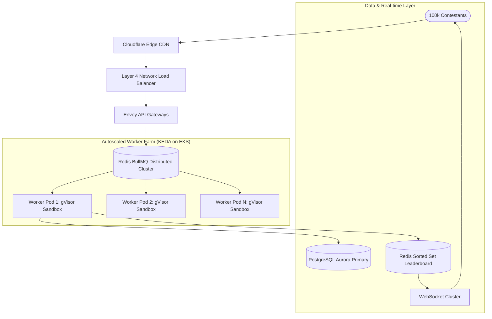
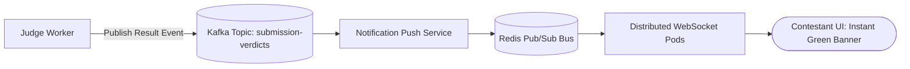
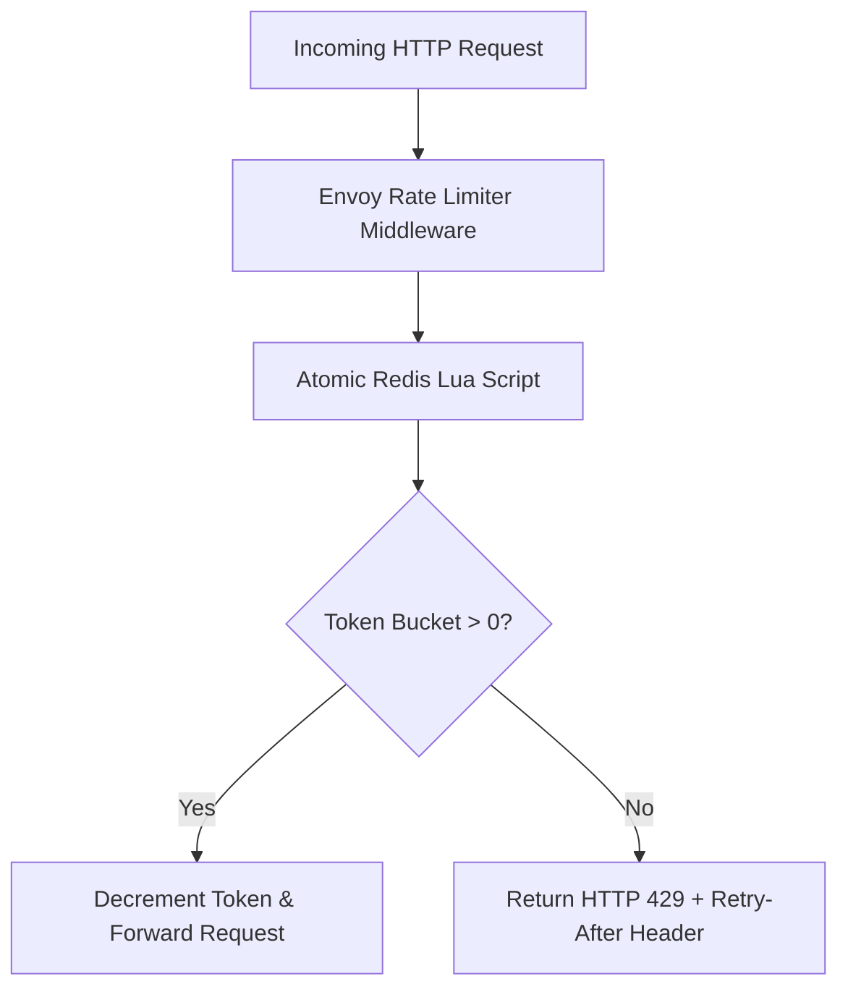
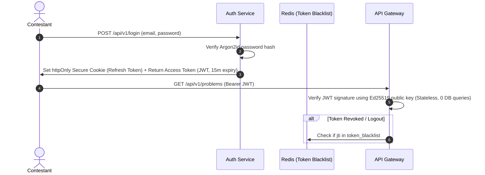

# 14.17 Classic System Design Interview Cases Applied to This Platform

This chapter presents comprehensive, interview-ready system design solutions applying the architectural building blocks of this platform to classic industry design problems.

---

## Case 1: Design This System at 100x Scale (The Distributed Code Judge)



- **Requirements**: Evaluate 1,000,000 daily submissions with 3,000 test-case executions/sec peak; p95 latency $< 2.5\text{s}$; isolated multi-tenancy.
- **Deep Dive**: Ingress gateways return immediate `202 Accepted` job tokens; workers pull jobs from Redis BullMQ queues; evaluations run inside gVisor `runsc` containers with Cgroup v2 quotas; test cases are cached in `/dev/shm` RAM disks.
- **Bottlenecks & Trade-offs**: High worker CPU spend ($4,850/mo) accepted to ensure total host kernel isolation.

---

## Case 2: Design the Real-Time Notification & Live Grading System



- **Requirements**: Push test-pass notifications and leaderboard changes to 100,000 active contestants within 100ms of evaluation completion.
- **Deep Dive**: When a worker finishes, it emits a compact event into Redis Pub/Sub; WebSocket gateway pods holding the student's socket deliver the payload over persistent TCP connections.
- **Bottleneck**: Connection storms on contest completion; mitigated by heartbeat pruning and connection rate smoothing.

---

## Case 3: Design the Rate Limiter



- **Requirements**: Restrict submissions to 1 per 5 seconds per user; restrict global API queries to 100 requests per minute per IP.
- **Deep Dive**: Utilizes an atomic Redis Lua script implementing the **Token Bucket** algorithm, supporting burst traffic while strictly capping sustained rate without race conditions.

---

## Case 4: Design the Authentication & Session System



- **Requirements**: Secure authentication for 100,000 contestants; zero database queries on hot API paths.
- **Deep Dive**: Dual-token architecture using stateless Ed25519-signed JWTs (15-minute lifespan) and httpOnly refresh cookies, with Redis storing revoking blacklists.

---

## Case 5: Design the AI Request Pipeline (Queueing, Caching & Fallbacks)

```mermaid
flowchart TD
    Fail[Failed Submission Event] --> Queue[(Redis AI Queue)]
    Queue --> Worker[AI Mentor Worker]
    Worker --> HashCheck{Hash of AST + Test Case in Redis?}
    HashCheck -->|Hit (65% of cases)| Cached[Return Cached Feedback Instantly]
    HashCheck -->|Miss| CircuitBreaker{Claude 3.5 Healthy?}
    CircuitBreaker -->|Closed / Healthy| CallClaude[Call Claude 3.5 Sonnet API]
    CircuitBreaker -->|Open / Tripped| Fallback[Fallback to OpenAI GPT-4o Mini]
    CallClaude --> Save[Save to Cache & Push to User]
    Fallback --> Save
```

- **Requirements**: Generate pedagogical hints for failing code without crashing under traffic spikes or incurring extreme API costs.
- **Deep Dive**: Asynchronous evaluation decoupled from grading; AST-based prompt caching; circuit breaker failing over between Anthropic and OpenAI APIs.

---

## Case 6: Reusing Core Building Blocks for Classic Archetypes

| Classic Archetype | How This Project's Architecture Reuses Core Primitives |
| :--- | :--- |
| **URL Shortener** | Reuses PostgreSQL B-tree indexed storage and Base62 integer hash conversion derived from submission IDs. |
| **Distributed Chat System** | Reuses horizontal WebSocket gateways and Redis Pub/Sub channels partitioned by contest room. |
| **Contest News Feed** | Reuses Redis Sorted Sets (`ZSET`) where scores represent publication timestamps (`ZREVRANGEBYSCORE`). |
| **Real-time Collaborative Code Editor** | Reuses WebSocket multiplexing and operational transform/CRDT message passing over the Redis backplane. |
