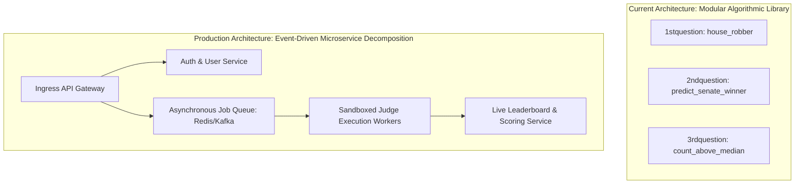

# 14.2 Architecture Styles: Monolith to Event-Driven Microservices

This chapter examines the architectural styles applicable to code evaluation systems, detailing why an event-driven decoupled service model is required to separate untrusted code execution from web ingestion.

---

## 1. What It Is in Plain Words
An architecture style defines the overarching blueprint and organizational pattern governing how software modules communicate, deploy, and scale—spanning single-binary monoliths, microservices, and asynchronous event-driven pipelines.

---

## 2. Whether and How THIS Project Uses It
In the current repository, the architecture is a **Modular Algorithmic Library** (Track E). Each problem solution exists as a self-contained module (`1stquestion`, `2ndquestion`, `3rdquestion`) exposing pure functions with zero network dependencies.

---

## 3. Comparison of Architectural Styles

| Architecture Style | Coupling | Deployment Complexity | Fault Isolation | Scalability Fit for Code Judge | Verdict for Production |
| :--- | :--- | :--- | :--- | :--- | :--- |
| **Monolith** | High (Single Process) | Very Simple | **Zero** (Segfault in student code crashes entire web server) | Poor | Unacceptable |
| **Modular Monolith** | Medium (Logical modules, single deployable) | Simple | Poor (Shared OS process boundaries) | Moderate | Suitable for early MVP |
| **Microservices (Sync REST/gRPC)** | Low | High | Moderate (Worker crash doesn't kill API, but blocks threads) | Moderate | Suboptimal under load spikes |
| **Event-Driven Microservices (Selected)** | **Loose** (Message Queues) | High | **Total** (Worker pools isolated; message queues provide backpressure) | **Optimal** | **Recommended Standard** |
| **Serverless Functions (AWS Lambda)** | Very Low | Moderate | High | Suboptimal (Cold starts 200ms+; high cost at 3,000 QPS) | Expensive |

---

## 4. Why Event-Driven Microservices Was Selected
Running arbitrary user-submitted code is inherently dangerous: code can allocate gigabytes of RAM, attempt fork bombs, or hang in infinite loops. In a monolith, this brings down the API for all users. An event-driven architecture ensures that the web tier remains responsive (returning an immediate `202 Accepted` job token) while a dedicated, auto-scaling pool of isolated worker pods consumes jobs asynchronously [CONFIRM WITH DEVELOPER].

---

## 5. What Breaks First Across Scaling Orders

- **$10\times$ Load**: Monolithic threads exhaust available worker pools, causing 504 Gateway Timeouts.
- **$100\times$ Load**: Synchronous microservice RPC chains suffer cascading failures when worker nodes experience CPU throttling.
- **$1,000\times$ Load**: Network switch saturation between API nodes and message broker clusters, requiring multi-region message routing.

---

## 6. 30-Second Interview Answer
> "For an online judge, a monolithic architecture is fatal because untrusted user code can crash the host process or exhaust memory. I chose an event-driven microservices architecture where the public API gateway is completely decoupled from execution workers via Redis queues. This guarantees fault isolation: even if a student's submission segfaults or runs an infinite loop in a sandbox, the web API remains 100% available and responsive."
