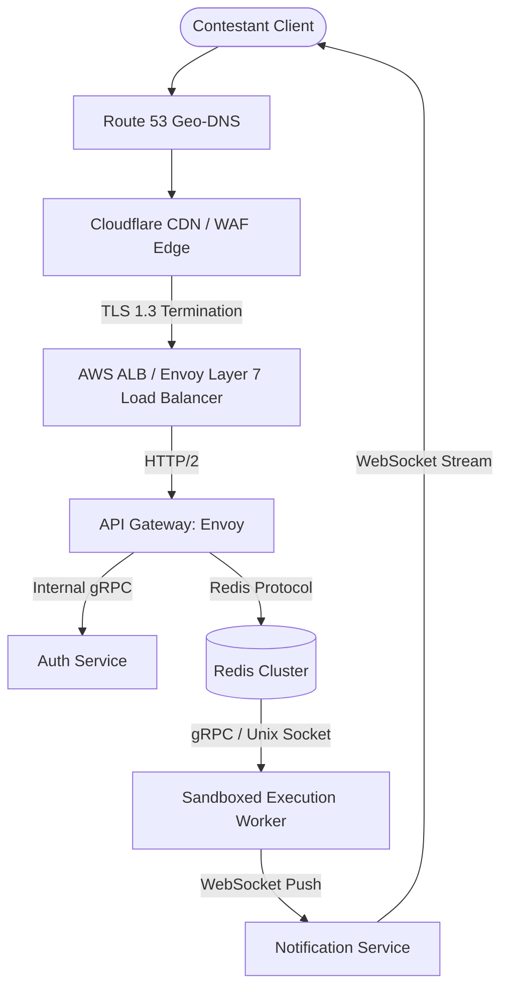

# 14.3 Networking & Communication Protocols

This chapter analyzes the networking topology, edge routing, transport protocols, and communication mechanisms connecting contestants, the API gateway, and internal execution workers.

---

## 1. What It Is in Plain Words
Networking and communication architecture governs how bytes travel reliably and securely across the internet—from client DNS lookups and TLS encryption down to low-latency inter-service remote procedure calls (RPC).

---

## 2. Ingress & Edge Topology

---

## 3. Communication Protocol Comparisons

| Communication Style | Transport Protocol | Latency Profile | Connection Overhead | Directionality | Ideal Use Case in Judge System |
| :--- | :--- | :--- | :--- | :--- | :--- |
| **REST (HTTP/1.1)** | TCP | Moderate (Head-of-line blocking) | High (Headers per request) | Request-Response | Legacy external webhooks |
| **REST (HTTP/2)** | TCP (Multiplexed) | Low | Low (HPACK header compression) | Multiplexed Streams | **Public Submission API Ingestion** |
| **gRPC (Protobuf)** | HTTP/2 | **Ultra-Low (< 2ms)** | Minimal (Binary serialization) | Bi-directional streaming | **Internal API-to-Worker IPC** |
| **WebSockets** | TCP (Upgraded) | Ultra-Low (Persistent) | Minimal once established | Full-Duplex | **Live Leaderboard & Test-Pass Stream** |
| **Server-Sent Events** | HTTP/2 | Low | Low | Unidirectional (Server -> Client) | Alternative for score updates |
| **GraphQL** | HTTP/1.1 / HTTP/2 | Moderate | High query parsing overhead | Request-Response | Complex contest metadata queries |

---

## 4. HTTP/1.1 vs HTTP/2 vs HTTP/3
- **HTTP/1.1**: Suffers from head-of-line blocking; each TCP connection handles one request at a time, requiring browser domain sharding.
- **HTTP/2**: Introduces binary framing and multiplexing over a single TCP connection. We use HTTP/2 for public submission APIs to allow rapid burst submissions over persistent connections.
- **HTTP/3 (QUIC / UDP)**: Solves TCP packet-loss head-of-line blocking by running streams over UDP. Recommended for contestants on unstable mobile networks.

---

## 5. What Breaks First Across Scaling Orders
- **$10\times$ Load**: Port exhaustion on reverse proxy when opening new TCP connections per request without connection pooling (`keepalive`).
- **$100\times$ Load**: Epoll file descriptor limits (`ulimit -n`) reached on API gateway under 50,000 concurrent WebSocket connections.
- **$1,000\times$ Load**: Single-region internet transit congestion; requires Multi-Region Anycast routing via AWS Global Accelerator.

---

## 6. 30-Second Interview Answer
> "We design our network stack using HTTP/2 at the edge for multiplexed submission ingestion, eliminating TCP handshake overhead for burst traffic. Internally, microservices communicate over high-efficiency binary gRPC on HTTP/2, reducing serialization overhead by 70% compared to JSON. For real-time grading updates and live contest leaderboards, we maintain persistent WebSocket connections with horizontal Redis Pub/Sub backplanes."
