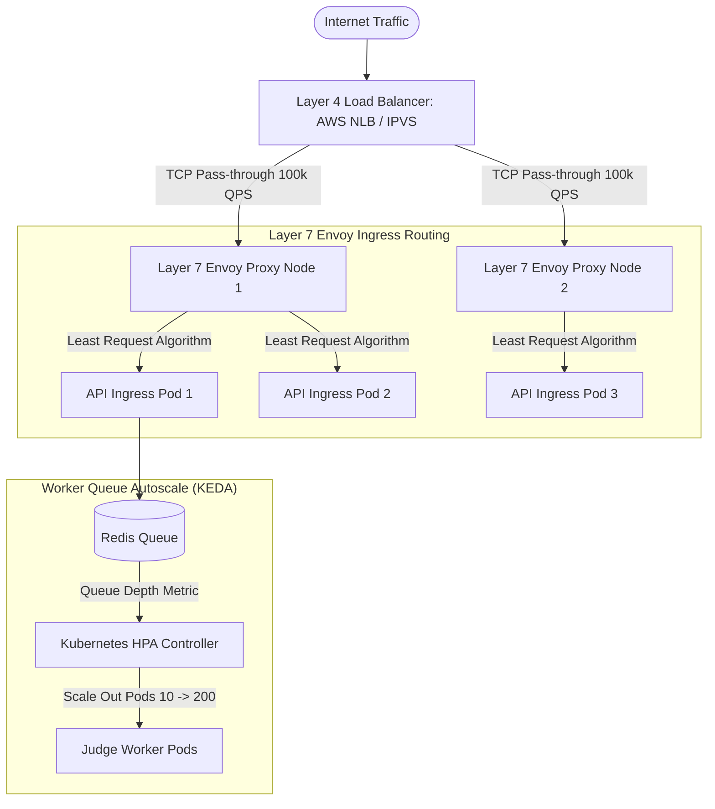

# 14.4 Load Balancing & Autoscaling Architecture

This chapter specifies load distribution mechanisms, reverse proxy policies, horizontal pod autoscaling algorithms, and zero-downtime deployments for the evaluation platform.

---

## 1. What It Is in Plain Words
Load balancing distributes incoming client requests across a pool of compute servers to ensure no single server becomes overwhelmed, maximizing throughput and minimizing latency.

---

## 2. Load Balancing Topology & Layered Routing

---

## 3. Load Balancing Algorithm Comparison

| Algorithm | Routing Criteria | Server State Awareness | Best Suited Tier in Judge | Limitations |
| :--- | :--- | :--- | :--- | :--- |
| **Round Robin** | Sequential rotation | None | Static asset servers | Can overload nodes processing heavy evaluations |
| **Weighted Round Robin** | Weighted rotation by capacity | Static weight | Heterogeneous worker sizes | Static; does not adapt to dynamic queue depth |
| **Least Connections / Least Request (Selected)** | Node with fewest active requests | Dynamic real-time | **Public API Gateway** | Slight overhead tracking connection counters |
| **Consistent IP Hashing** | Hash of client IP modulo ring | Static hash ring | Sticky WebSocket sessions | Uneven distribution if large universities share single NAT IP |
| **Queue-Based Pull (Worker Dequeue)** | Workers pull when idle | Perfect (Self-paced) | **Execution Worker Pool** | Requires a centralized queue broker |

---

## 4. Single Points of Failure (SPOF) & Redundancy Plan

| Potential SPOF | Impact of Failure | Redundancy & High Availability Mitigation |
| :--- | :--- | :--- |
| **Single Ingress Gateway** | Complete API outage | Multi-AZ deployment behind AWS Network Load Balancer (NLB) with active health checks |
| **Single Redis Broker** | Submissions cannot be enqueued | Multi-node Redis Cluster with Sentinel automatic leader failover and replication |
| **Worker Host Failure** | In-flight execution crashes | At-least-once message delivery via BullMQ with automatic job redelivery to healthy nodes |
| **PostgreSQL Database** | Score updates and authentication lost | Primary-Replica streaming replication with automated Patroni / AWS Aurora multi-AZ failover |

---

## 5. What Breaks First Across Scaling Orders
- **$10\times$ Load**: API gateway runs out of memory if request body buffering is enabled on large code submissions.
- **$100\times$ Load**: Worker pod autoscaling latency (takes 45–90s to spin up new Kubernetes nodes on AWS EKS). **Fix**: Pre-scale worker instances 15 minutes before scheduled contests.
- **$1,000\times$ Load**: Network interface saturation (10Gbps to 100Gbps) on the central Redis cluster nodes.

---

## 6. 30-Second Interview Answer
> "We employ a two-tier load balancing strategy: Layer 4 AWS NLBs handle ultra-high TCP throughput and pass traffic to Layer 7 Envoy proxies using the 'Least Request' algorithm. To scale the execution worker tier, we do not scale on CPU metrics alone; instead, we use KEDA to autoscale worker pods directly based on Redis queue depth, ensuring workers scale out instantly when contest submission bursts occur."
