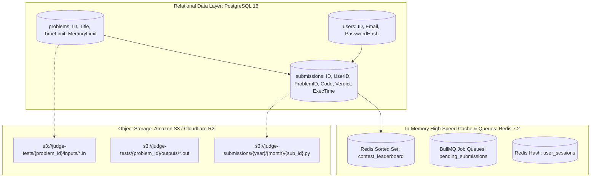

# 14.5 Databases, Persistence & Storage Architecture

This chapter details the data modeling, database selection matrices, indexing strategies, and multi-tier storage architecture required for a high-concurrency online code judge.

---

## 1. What It Is in Plain Words
Database architecture determines how application state—such as user credentials, problem statements, test cases, code submissions, and contest rankings—is durably stored, indexed, queried, and backed up across storage engines.

---

## 2. Multi-Tier Storage Topology & Data Placement



---

## 3. Database Selection Matrix

| Database Engine | Data Model | ACID Compliance | Write Scalability | Query Flexibility | Best Suited Role in Judge Platform |
| :--- | :--- | :--- | :--- | :--- | :--- |
| **PostgreSQL 16 (Selected)** | Relational (SQL) + JSONB | **Strict ACID (Serialisable / Read Committed)** | High (Single Leader + Read Replicas) | **Ultra-High (Complex joins, window funcs, GIN indexes)** | **Primary System of Record (Users, Problems, Submissions)** |
| **MongoDB** | Document (BSON) | Multi-document ACID | High | Moderate (No relational foreign key constraints) | Contest submission logs (Suboptimal for strict user/contest relations) |
| **MySQL 8.0** | Relational (InnoDB) | Strict ACID | High | High | Viable alternative to Postgres |
| **CockroachDB** | Distributed SQL (NewSQL) | Multi-Region ACID | Very High (Horizontal scale) | High (Postgres wire compatible) | Global multi-region deployment at massive scale |
| **Redis 7.2 (Selected)** | In-Memory Key-Value / ZSet | In-memory atomic commands | Ultra-High (> 100k QPS) | Specialized data structures | **Job Queue, Leaderboards, Rate Limiting** |
| **Amazon S3 / R2 (Selected)**| Object Storage (Blob) | Eventual / Strong Read-After-Write | Infinite (Scale out) | Key-based fetch | **Large Test Case Files (inputs/outputs > 10MB)** |
| **DynamoDB** | NoSQL Key-Value / Doc | Configurable (Single-key ACID) | Infinite | Low (Query restricted to Partition/Sort keys) | User session tokens |

---

## 4. PostgreSQL Relational Schema Design

```sql
-- Contestants
CREATE TABLE users (
    id UUID PRIMARY KEY DEFAULT gen_random_uuid(),
    username VARCHAR(50) UNIQUE NOT NULL,
    email VARCHAR(255) UNIQUE NOT NULL,
    password_hash VARCHAR(255) NOT NULL,
    created_at TIMESTAMPTZ DEFAULT NOW()
);

-- Algorithmic Challenges (F1, F2, F3)
CREATE TABLE problems (
    id UUID PRIMARY KEY DEFAULT gen_random_uuid(),
    slug VARCHAR(100) UNIQUE NOT NULL,
    title VARCHAR(200) NOT NULL,
    time_limit_ms INTEGER NOT NULL DEFAULT 1000,
    memory_limit_mb INTEGER NOT NULL DEFAULT 128,
    test_case_s3_prefix VARCHAR(500) NOT NULL,
    created_at TIMESTAMPTZ DEFAULT NOW()
);

-- Submissions Ledger
CREATE TABLE submissions (
    id UUID PRIMARY KEY DEFAULT gen_random_uuid(),
    user_id UUID NOT NULL REFERENCES users(id) ON DELETE CASCADE,
    problem_id UUID NOT NULL REFERENCES problems(id) ON DELETE RESTRICT,
    language VARCHAR(20) NOT NULL DEFAULT 'python3',
    source_code TEXT NOT NULL,
    verdict VARCHAR(30) NOT NULL DEFAULT 'PENDING', -- AC, WA, TLE, MLE, RTE
    execution_time_ms INTEGER,
    memory_used_kb INTEGER,
    created_at TIMESTAMPTZ DEFAULT NOW()
);

-- Performance Indexes
CREATE INDEX idx_submissions_user_problem ON submissions(user_id, problem_id);
CREATE INDEX idx_submissions_created_at_desc ON submissions(created_at DESC);
CREATE INDEX idx_submissions_verdict ON submissions(verdict) WHERE verdict = 'PENDING';
```

---

## 5. Storage Tiering: Why Test Cases Belong in S3, Not PostgreSQL
Storing large arrays (e.g., $10^5$ integers for House Robber or Dota2 Senate test cases) inside PostgreSQL database rows causes massive table bloat, degrades buffer pool cache hit ratios, and increases vacuum overhead. Instead, we store immutable test case files in **Amazon S3 / Cloudflare R2** and cache them on worker local RAM disks (`/dev/shm`), keeping PostgreSQL lean for metadata and transactional records.

---

## 6. What Breaks First Across Scaling Orders
- **$10\times$ Load**: Database connection pool exhaustion (`max_connections = 100` reached). **Fix**: Deploy **PgBouncer** connection pooler in transaction pooling mode.
- **$100\times$ Load**: Disk I/O bottlenecks on PostgreSQL primary node due to 1,000 writes/sec during contest submission rush. **Fix**: Split read queries (contest browsing, submission history) to read replicas; batch score updates.
- **$1,000\times$ Load**: Table size exceeds 500 million rows ($100\text{ GB+}$). **Fix**: Partition `submissions` table by `created_at` (monthly range partitioning) and archive older contest data to cold S3 storage via Parquet.

---

## 7. 30-Second Interview Answer
> "We separate storage into three specialized tiers: PostgreSQL acts as our primary transactional system of record for users, problem rules, and submission statuses, utilizing B-tree and partial indexes with PgBouncer connection pooling. S3 object storage holds large, immutable test-case input/output files to prevent database bloat. Finally, Redis handles high-velocity transient state: managing the submission job queue and maintaining live contest leaderboards via sorted sets with sub-millisecond query latency."
