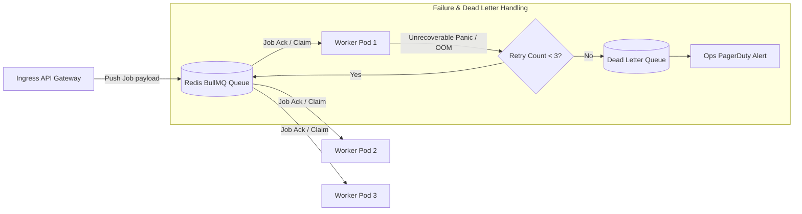

# 14.7 Messaging, Asynchronous Queues & Event Streaming

This chapter analyzes asynchronous messaging brokers, delivery semantics, dead-letter recovery, and backpressure mechanisms decoupling code submission ingestion from sandboxed worker execution.

---

## 1. What It Is in Plain Words
Asynchronous messaging decouples producers (web servers receiving student code) from consumers (sandboxed execution workers) using intermediary buffers, allowing systems to absorb bursts of traffic without dropping requests or freezing server threads.

---

## 2. Ingestion Pipeline & Worker Dequeue Architecture

---

## 3. Message Broker Comparison

| Broker / Technology | Architecture | Throughput | Persistence | Latency | Delivery Guarantee | Best Fit in Judge System |
| :--- | :--- | :--- | :--- | :--- | :--- | :--- |
| **BullMQ on Redis (Selected)** | In-Memory FIFO Queue | **High (50k–100k ops/sec)** | RDB / AOF snapshotting | **Sub-millisecond (< 1ms)** | At-least-once | **Real-Time Code Evaluation Queue** |
| **Apache Kafka** | Distributed Partitioned Log | Ultra-High (> 1M msgs/sec) | Distributed Disk Commit Log | Low (5–15ms) | At-least-once | High-volume submission audit log stream |
| **RabbitMQ** | AMQP Message Broker | Moderate (20k–50k msgs/sec) | Disk / RAM Queues | Low (2–5ms) | At-least-once | Complex enterprise routing |
| **AWS SQS** | Cloud Managed Queue | High (Auto-scaled) | Multi-AZ Cloud Storage | Moderate (20–40ms) | At-least-once | Serverless background tasks |

---

## 4. Delivery Semantics & Idempotency
- **At-Least-Once Delivery**: To guarantee no submission is lost if a worker pod crashes mid-execution, workers do not acknowledge (`ack`) the job until evaluation concludes and results are committed to PostgreSQL. If the worker dies, Redis re-enqueues the job after a visibility timeout (e.g., 30 seconds).
- **Idempotent Consumers**: Because at-least-once delivery can cause a job to be processed twice, workers check PostgreSQL for an existing completed verdict for that submission UUID before re-running the test suite, preventing duplicate score records.
- **Dead Letter Queue (DLQ)**: If a submission crashes workers 3 consecutive times (e.g., triggering a kernel segfault in gVisor), it is routed to the DLQ with verdict `INTERNAL_SYSTEM_ERROR`, alerting on-call engineers.

---

## 5. What Breaks First Across Scaling Orders
- **$10\times$ Load**: Visibility timeout set too short (e.g., 5 seconds) causing long-running $O(N)$ solutions to be redelivered while still executing. **Fix**: Dynamically extend visibility timeout via heartbeats.
- **$100\times$ Load**: Redis queue memory exhaustion if massive bursts occur and workers cannot keep pace. **Fix**: Implement backpressure at the API gateway, returning HTTP `429 Too Many Requests` when queue depth exceeds 20,000 jobs.
- **$1,000\times$ Load**: Single Redis instance queue lock contention. **Fix**: Transition to **Kafka** partitioned topics sharded by `problem_id` or `contest_id`.

---

## 6. 30-Second Interview Answer
> "We use BullMQ on Redis as our core message broker because it provides sub-millisecond job dispatch latency and native priority queuing. To guarantee reliability, we operate with at-least-once delivery: workers hold a job lock with automated heartbeat renewals, acknowledging completion only after writing results to PostgreSQL. If an unrecoverable failure occurs, jobs retry up to three times before routing to a Dead Letter Queue, ensuring zero dropped submissions."
