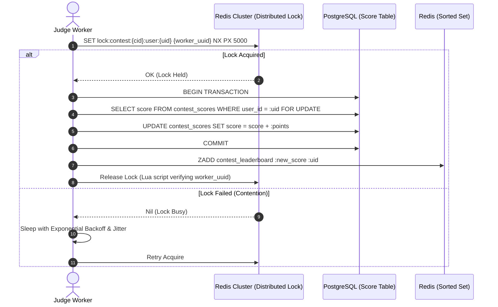

# 14.8 Consistency, Concurrency & Distributed Coordination

This chapter analyzes distributed consistency guarantees, race condition mitigation, locking semantics, and consensus protocols in high-concurrency coding contests.

---

## 1. What It Is in Plain Words
Distributed consistency and concurrency control guarantee that even when hundreds of servers and threads read and write data simultaneously over an imperfect network, all operations observe an agreed-upon, correct state without corrupted records or race conditions.

---

## 2. Distributed Locking & Score Update Flow

---

## 3. Concurrency Control Mechanisms Comparison

| Mechanism | Description | Contention Overhead | Deadlock Risk | Throughput Under High Contention | Fit for Score Updates |
| :--- | :--- | :--- | :--- | :--- | :--- |
| **Optimistic Concurrency Control (OCC)** | Verifies version column on update (`WHERE version = 1`) | **Zero during read** | None | Low (High abort/retry rates under contention) | Suboptimal for fast scoring |
| **Pessimistic Row Locking (`SELECT FOR UPDATE`)** | Holds database row lock for duration of transaction | Low on single DB | High if multi-table locks misordered | Moderate | Viable on PostgreSQL |
| **Distributed Redis Lock (Redlock / SET NX)** | In-memory atomic lock with TTL lease | **Very Low (< 1ms)** | None (Auto-expires on TTL) | **High** | **Recommended for multi-service coordination** |
| **Atomic Counter (`INCRBY` / `HINCRBY`)** | Single atomic in-memory operation in Redis | Minimal | Zero | **Ultra-High (> 100k ops/sec)** | **Optimal for raw score increments** |

---

## 4. Race Conditions in Contest Systems & Mitigations
1. **Double Submission Race**: A user double-clicks the "Submit" button within 50 milliseconds.
   - **Mitigation**: The API gateway generates a deterministic idempotency key `hash(user_id, problem_id, code_hash)` and executes `SET key 1 NX EX 5`. The second request returns HTTP `409 Conflict`.
2. **Concurrent Score Overwrite**: Two workers grade two different submissions from the same user simultaneously.
   - **Mitigation**: Database update uses atomic SQL addition `UPDATE user_scores SET score = score + :val` or uses a distributed Redis lock per user.

---

## 5. What Breaks First Across Scaling Orders
- **$10\times$ Load**: Database row lock contention on global contest metadata row. **Fix**: Never lock the entire contest table; lock only user-specific rows.
- **$100\times$ Load**: Redis lock TTL expiration occurring while a worker is experiencing GC pause, allowing a second worker to acquire the lock concurrently. **Fix**: Use background lock renewal threads.
- **$1,000\times$ Load**: Cross-datacenter clock drift breaking timestamp-based tie-breakers. **Fix**: Use distributed consensus sequencers (Raft / Snowflake UUIDs) for monotonic order.

---

## 6. 30-Second Interview Answer
> "To prevent race conditions during concurrent submissions, we enforce idempotency at the API gateway using Redis atomic `SET NX` keys. For score increments, rather than performing read-modify-write cycles in the database, we use atomic SQL increments and distributed Redis locks with TTL safety leases. This eliminates dirty writes and lost updates, guaranteeing strict score consistency across hundreds of concurrent worker threads."
