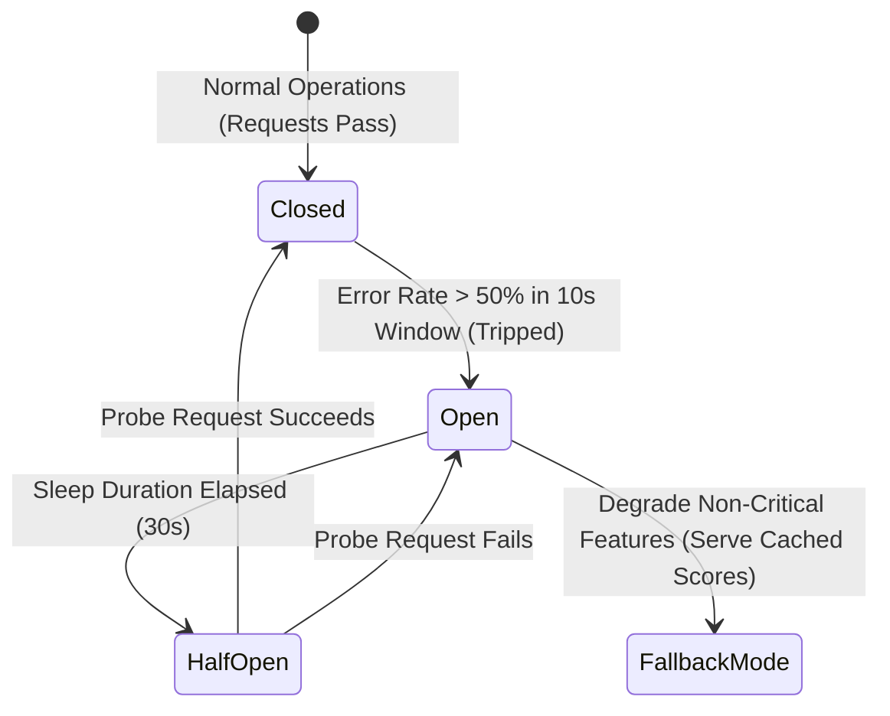

# 14.9 Reliability, Fault Tolerance & Resilience Patterns

This chapter details resilience mechanisms, circuit breakers, graceful degradation, and disaster recovery strategies ensuring continuous availability during peak contest operations.

---

## 1. What It Is in Plain Words
Reliability and resilience define a system's ability to remain functional, handle partial infrastructure failures gracefully, and self-heal without cascading outages or corrupted user data.

---

## 2. Circuit Breaker State Transition & Graceful Degradation

---

## 3. Resilience Patterns Comparison

| Resilience Pattern | Purpose | Mechanism | Behavior Under Partial Outage | Fit in Code Judge |
| :--- | :--- | :--- | :--- | :--- |
| **Circuit Breaker** | Prevent cascading failures | Trips to open state when downstream service fails | Returns immediate cached fallback without calling failing service | Applied to AI hint generation & external analytics |
| **Bulkhead** | Resource isolation | Partitions worker pools by problem or contest priority | Outage in Problem 1 workers does not affect Problem 2 workers | **Core Worker Architecture** |
| **Retry with Exponential Backoff & Full Jitter** | Handle transient network blips | Formula: $t = \text{rand}(0, \min(M, B \times 2^{\text{attempt}}))$ | Spreads retries evenly over time, preventing thundering herds | Internal gRPC & DB connections |
| **Load Shedding** | Protect servers from total collapse | Rejects incoming non-essential requests when CPU $> 85\%$ | Drops contest leaderboard polling; prioritizes code submission ingestion | **Edge Ingress Gateway** |
| **Graceful Degradation** | Maintain core functionality | Disables heavy features during high load | Hides live syntax checkers; queues code evaluation | **Contest Survival Mode** |

---

## 4. Availability Targets (SLI, SLO, SLA)
- **Service Level Indicator (SLI)**: Percentage of successful submission evaluations completed in $< 3.0\text{ seconds}$ without 5xx errors.
- **Service Level Objective (SLO)**: $99.9\%$ successful evaluations over any 30-day window ($< 43.8\text{ minutes}$ downtime/month).
- **Service Level Agreement (SLA)**: $99.5\%$ uptime; service credits issued if downtime exceeds 3.6 hours in a month.

---

## 5. What Breaks First Across Scaling Orders
- **$10\times$ Load**: Unbounded retries without jitter trigger a "retry storm," swamping recovering database instances.
- **$100\times$ Load**: Bulkhead partitions set too rigidly; workers for Problem 1 sit idle while Problem 2 queues overflow. **Fix**: Use dynamic worker work-stealing algorithms.
- **$1,000\times$ Load**: Cross-region fiber cuts between primary database and secondary standby. **Fix**: Pre-configured automatic DNS failover with Route 53 health probes.

---

## 6. 30-Second Interview Answer
> "We design for failure at every tier using battle-tested resilience patterns: worker pools are partitioned using bulkheads so that a pathological submission on one problem cannot starve another. Internal network calls use retries with exponential backoff and full jitter to prevent retry storms, while circuit breakers wrap non-critical integrations like AI grading. During extreme traffic spikes, we activate load shedding at the API gateway, shedding real-time leaderboard polling to protect core code evaluation pipelines."
